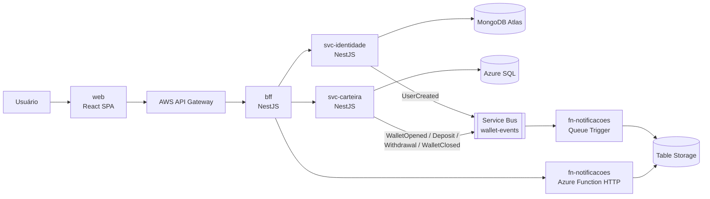

# Carteira Digital

Projeto PJBL da disciplina **Arquitetura de Soluções com Cloud** (PUCPR), Entrega 3.

É uma carteira digital distribuída. Usuários (MongoDB) podem abrir uma carteira (Azure SQL), depositar, sacar e consultar o extrato. Cada operação gera um evento que uma Azure Function consome para montar o feed de atividade e o score financeiro. O frontend só conversa com o BFF, que fica atrás do AWS API Gateway.

## Links da entrega

| Item | Link |
|---|---|
| Frontend (Azure Container Apps) | https://web.wonderfuldune-fe1dc2f4.canadacentral.azurecontainerapps.io |
| API Gateway (AWS) | https://i12uxusdx6.execute-api.us-east-1.amazonaws.com |
| Swagger — BFF (via API Gateway) | https://i12uxusdx6.execute-api.us-east-1.amazonaws.com/docs |
| Swagger — svc-identidade (MongoDB) | https://svc-identidade.wonderfuldune-fe1dc2f4.canadacentral.azurecontainerapps.io/docs |
| Swagger — svc-carteira (Azure SQL) | https://svc-carteira.wonderfuldune-fe1dc2f4.canadacentral.azurecontainerapps.io/docs |
| Azure Function (score) | https://func-pjbl-cd-fpfbg6c3axgwh5b2.canadacentral-01.azurewebsites.net/api/insights |
| Swagger — Eventos (AsyncAPI) | _a preencher_ ([fonte](docs/events/asyncapi.yaml)) |
| Docker Hub | _a preencher_ |
| GitHub | https://github.com/lucasreali/digital-wallet-monorepo |
| Vídeo (YouTube, não listado) | _a preencher_ |
| Documentação arc42 (PDF) | [docs/Carteira-Digital-Arquitetura-arc42-1.pdf](docs/Carteira-Digital-Arquitetura-arc42-1.pdf) |

A apresentação em vídeo usa só estas URLs públicas na nuvem, nunca `localhost`. O frontend, o BFF e os microsserviços rodam no Azure Container Apps, a Function no Azure Functions e o API Gateway na AWS. O frontend chama só o API Gateway.

## Arquitetura



| # | Componente | Pasta | Tecnologia | Responsabilidade |
|---|---|---|---|---|
| 1 | Microfrontend | [`apps/web`](apps/web) | React, TanStack Start/Router/Query/Form/Table, Base UI, Kubb | Interface; consome **apenas** o BFF |
| 2 | BFF | [`apps/bff`](apps/bff) | NestJS + Fastify | Proxy do CRUD e `GET /aggregated-data` (Mongo + SQL + Function numa resposta só) |
| 3 | Microsserviço 1 | [`services/svc-identidade`](services/svc-identidade) | NestJS + Mongoose, MongoDB Atlas | Usuários: CRUD + Swagger |
| 4 | Microsserviço 2 | [`services/svc-carteira`](services/svc-carteira) | NestJS + TypeORM, Azure SQL | Carteiras, depósitos, saques, extrato: CRUD + regras + Swagger |
| 5 | Azure Function | [`services/fn-notificacoes`](services/fn-notificacoes) | Azure Functions v4 (Node) | Queue Trigger que consome os eventos; HTTP para score (`/api/insights`) e feed (`/api/activity`) |
| 6 | API Gateway | — | AWS API Gateway | Entrada única, roteamento e segurança na frente do BFF |
| 7 | Mensageria | — | Azure Service Bus | Fila `wallet-events` com os eventos de domínio |

Cada pasta tem seu próprio README explicando o componente.

### Fluxo do `GET /aggregated-data`

1. O usuário abre o Painel no frontend.
2. O frontend chama o API Gateway, que repassa para o BFF.
3. O BFF consulta em paralelo o svc-identidade (MongoDB), o svc-carteira (Azure SQL) e a fn-notificacoes (score).
4. O BFF devolve um único JSON com `users`, `wallets` e `insights`.

### Fluxo de eventos

| Evento | Publicado por | Quando |
|---|---|---|
| `UserCreated` | svc-identidade | Usuário criado |
| `WalletOpened` | svc-carteira | Carteira aberta |
| `Deposit` | svc-carteira | Depósito |
| `Withdrawal` | svc-carteira | Saque |
| `WalletClosed` | svc-carteira | Carteira encerrada |

Todos vão para a fila `wallet-events` no formato `{ id, type, occurredAt, data }`. A fn-notificacoes grava cada um na Table Storage, e a partir deles calcula o score (0 a 1000) e o feed de atividade. Canal e payloads estão documentados em AsyncAPI: [`docs/events/asyncapi.yaml`](docs/events/asyncapi.yaml).

## Requisitos de código

- **Clean Architecture**: em cada backend, `domain/` (entidades, portas, erros) → use cases (`*.use-case.ts`, sem Nest nem banco) → `infrastructure/` (Mongoose, TypeORM, HTTP, fila) → controllers (API). Os controllers dependem só dos use cases, nunca de repositórios.
- **Vertical Slice**: uma pasta por caso de uso em `src/features/` (`create-user`, `deposit`, `close-wallet`...). Um slice não importa outro.
- **Erros de domínio** mapeados para HTTP por um filtro (`NotFoundError` → 404, `ConflictError` → 409, demais → 422).
- **Testes unitários**: cada use case tem seu `*.use-case.spec.ts` com repositórios em memória (caminho feliz e cada erro de domínio). A fn-notificacoes testa o parser de eventos e o cálculo do score.
- **Testes de arquitetura**: `src/architecture.spec.ts` em cada backend, no estilo ArchUnit, garante as regras de camadas (domínio não importa framework, controller não importa porta, slice não importa slice...).

```bash
pnpm test     # todos os testes (Vitest, um projeto por pacote)
pnpm check    # Biome: formatação + lint
```

## Rodando localmente

Requisitos: Node 22+, pnpm, Docker e, para a Function, o [Azure Functions Core Tools](https://learn.microsoft.com/azure/azure-functions/functions-run-local).

```bash
pnpm install
docker compose up --build    # sobe tudo em containers
```

Ou com os bancos no Docker e as apps no host:

```bash
docker compose up mongo-identidade sql-carteira sql-carteira-init azurite
export AZURE_STORAGE_CONNECTION_STRING=UseDevelopmentStorage=true   # Table Storage da Function (Azurite)
export SERVICEBUS_CONNECTION_STRING='<connection string do Service Bus>'   # sem ela os eventos não são publicados
PORT=3001 pnpm --filter svc-identidade dev
PORT=3002 DB_PASSWORD='Carteira@Local123' DB_TRUST_CERT=true pnpm --filter svc-carteira dev
pnpm --filter bff dev
pnpm --filter fn-notificacoes build && (cd services/fn-notificacoes && func start)   # ServiceBusConnection em local.settings.json
pnpm --filter web dev
```

| App | Porta | Swagger |
|---|---|---|
| web | 5173 | — |
| bff | 3000 | http://localhost:3000/docs |
| svc-identidade | 3001 | http://localhost:3001/docs |
| svc-carteira | 3002 | http://localhost:3002/docs |
| fn-notificacoes | 7071 | — |

> Mac Apple Silicon: as imagens do SQL Server e do Azure Functions são só amd64. Ative Docker Desktop → Settings → General → "Use Rosetta for x86_64/amd64 emulation".

### Client do frontend gerado

O frontend não escreve chamadas HTTP à mão: tipos, client e hooks do TanStack Query são gerados pelo Kubb a partir do OpenAPI do BFF.

```bash
pnpm --filter bff openapi     # grava apps/bff/openapi.json
pnpm --filter web generate    # gera apps/web/src/gen
```

## Docker Hub

```bash
docker build -f Dockerfile.nest --build-arg APP=bff -t <user>/carteira-bff:v1 .
docker build -f Dockerfile.nest --build-arg APP=svc-identidade -t <user>/carteira-svc-identidade:v1 .
docker build -f Dockerfile.nest --build-arg APP=svc-carteira -t <user>/carteira-svc-carteira:v1 .
docker build -f services/fn-notificacoes/Dockerfile -t <user>/carteira-fn-notificacoes:v1 .
docker push <user>/carteira-<imagem>:v1
```

Todas as configurações (URLs, conexões, senhas) vêm de variáveis de ambiente; nenhum segredo fica no repositório.

## Integrantes

| Nome | RA / Matrícula |
|---|---|
| Lucas Reali | 40092691 |
| Guilherme Falde | 40101681 |
| Thiago Akimoto | 40090610 |
| Gabriel Conti | 40095589 |
