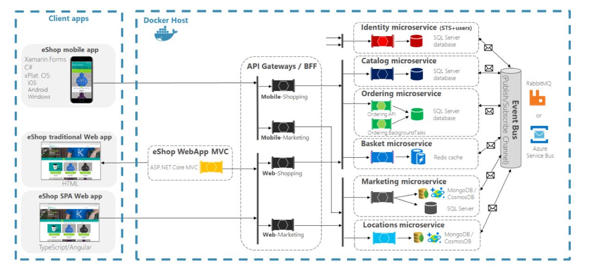
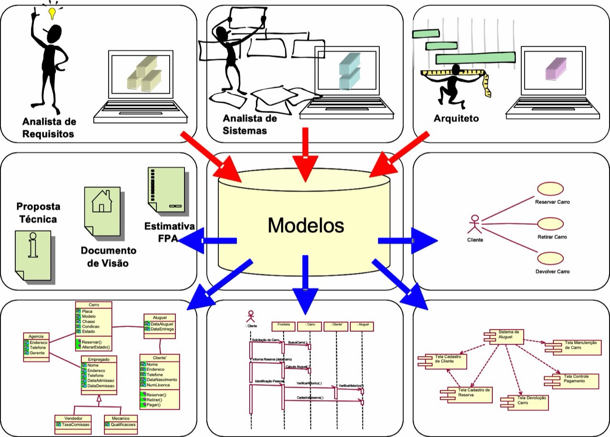
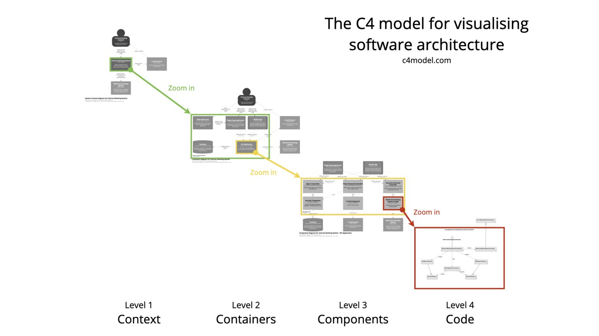
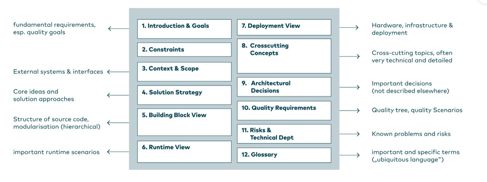
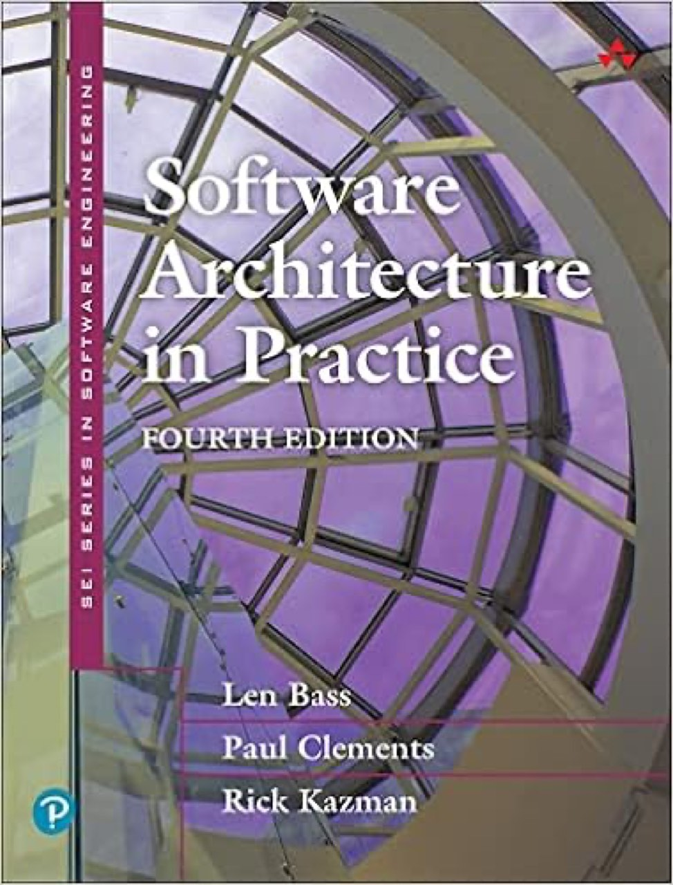
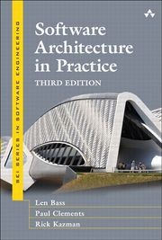
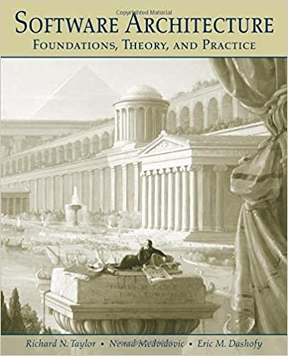
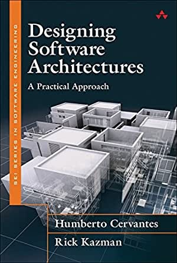
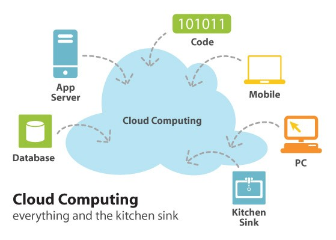

# ARQUITETURA_CLOUD_1

> Converted from `ARQUITETURA_CLOUD_1.pptx`.

## 1. Arquitetura e Soluções Cloud

## 2. Arquitetura de Software

Conceitos
Documentação
Padrões e Estilos Arquiteturais
Arquitetura Cloud
Qualidade em Arquitetura

## 3. Mapa Mental – Padrões e Estilo Arch.

## 4. Mapa Mental - UML

## 5. Mapa Mental – C4 Model

## 6. Mapa Mental – Documentação Arch42

[Documenting software architecture with arc42 – INNOQ](https://www.innoq.com/en/blog/2022/08/brief-introduction-to-arc42/)

## 7. O que é Arquitetura de Software?

Arquitetura de software refere-se à estrutura fundamental de um sistema de software, incluindo seus componentes, as relações entre eles e o ambiente em que operam. Essa disciplina é essencial para garantir que um software atenda a requisitos de qualidade, como confiabilidade e desempenho, e para facilitar a manutenção e evolução do sistema ao longo do tempo.
  - Arquitetura de software pode ser definida como a organização fundamental de um sistema, seus componentes, as relações entre eles e o ambiente que guia seu design e evolução. IEEE Standard 1471

## 8. A arquitetura de software de um programa ou sistema computacional é a estrutura ou estruturas do sistema que abrange os componentes de software, as propriedades externamente visíveis desses componentes e as relações entre eles. Bass, Clements e Kasman

## 9. (sem título)

## 10. Qual a definição  e importância da Arquitetura de Software?

A arquitetura de software é definida como um conjunto de decisões de design que afetam a estrutura e o comportamento do sistema. Essas decisões incluem a escolha de padrões arquiteturais, a definição de componentes e suas interações, e a consideração de requisitos funcionais e não funcionais. A arquitetura serve como um guia para o desenvolvimento, influenciando diretamente a qualidade do software e a eficiência do processo de desenvolvimento.

## 11. Quais os principais benefícios da Arquitetura de Software?

1. Padronização: A arquitetura proporciona diretrizes que permitem a padronização do código e da estrutura do software, facilitando sua manutenção e compreensão.
2. Reutilização de Componentes: Com uma arquitetura bem definida, é possível identificar e reutilizar componentes em diferentes projetos, economizando tempo e esforço.
3. Escalabilidade: Uma boa arquitetura permite que o sistema cresça e se adapte a novas demandas sem comprometer o desempenho, através de uma estrutura modular e separação de responsabilidades.
4.Qualidade do Software: A adoção de uma arquitetura sólida contribui para a confiabilidade e a eficiência do sistema, impactando positivamente a experiência do usuário final.

## 12. Estilos e Padrões Arquiteturais

Existem diversos estilos arquiteturais, como a Arquitetura em Camadas, Arquitetura MVC (Model-View-Controller) e Arquitetura de Microsserviços. Cada um desses estilos oferece diferentes abordagens para organizar componentes e gerenciar suas interações, influenciando a forma como o software é desenvolvido e mantido.

## 13. Conclusão Arquitetura Software

A arquitetura de software é uma disciplina crítica na engenharia de software, pois define a estrutura e as interações de um sistema, impactando diretamente sua qualidade e capacidade de evolução. A compreensão e a aplicação de boas práticas de arquitetura são fundamentais para o sucesso no desenvolvimento de sistemas complexos e escaláveis.

## 14. Arquitetura de soluções

Arquitetura de soluções é uma disciplina que se concentra em projetar e implementar soluções tecnológicas que atendem às necessidades específicas de uma organização. Essa abordagem envolve a análise das demandas do negócio e a criação de sistemas que otimizam processos, melhoram a eficiência e garantem a integração com a infraestrutura existente.

## 15. Qual o papel do arquiteto de soluções?

O arquiteto de soluções é responsável por alinhar os objetivos da empresa com as tecnologias disponíveis, criando um modelo que pode incluir a manutenção de sistemas existentes, a implantação de novos serviços e a gestão de dados. O trabalho desse profissional é crucial para garantir que as soluções propostas sejam viáveis e sustentáveis a longo prazo, atendendo tanto às necessidades atuais quanto futuras da empresa.

## 16. Atividades do Arquiteto de Soluções

As atividades de um arquiteto de soluções incluem:
Planejamento e desenvolvimento de sistemas e serviços.
Análise de requisitos para identificar soluções inovadoras.
Integração de novas tecnologias com sistemas existentes.
Avaliação de custos e benefícios das soluções propostas.

## 17. Qual a importância de arquitetura de soluções?

A arquitetura de soluções é vital em um ambiente de negócios competitivo, pois permite que as empresas se adaptem rapidamente às mudanças do mercado e às novas demandas dos clientes. Essa abordagem não apenas melhora a eficiência operacional, mas também contribui para a inovação e a vantagem competitiva.

## 18. Diferenças em Relação à Arquitetura de Software

Embora os termos "arquitetura de soluções" e "arquitetura de software" sejam frequentemente confundidos, eles têm focos distintos. A arquitetura de soluções é mais ampla e se concentra em como as tecnologias se encaixam nas necessidades do negócio, enquanto a arquitetura de software se concentra nos detalhes técnicos e na implementação de sistemas específicos.
A arquitetura de soluções, portanto, é uma área crítica que combina conhecimentos técnicos e comerciais para criar soluções eficazes e alinhadas com os objetivos estratégicos das organizações.

## 19. ARQUITETURA DE SOFTWARE?

## 20. CHALLENGE BASED LEARNING

- Metodologia Ativa de Aprendizagem focada na resolução de  desafios
- Basicamente é a  organização do caos  da aprendizagem
- Link:  challengebasedlearning.org

## 21. Atividade Formativa

Em grupo (4 ou 5 pessoas):
- Desafio: Arranjar um bom emprego como Arquiteto de Software
- Tempo: 20 minutos
- Apresentação: até 3 minutos
  - Pesquisar as HARD SKILL’s para se tornar um arquiteto de software e soluções.
  - Pesquisar certificações relativas a arquitetura de software.

## 22. Atividade Formativa

Pesquisar na internet sistemas de grande porte e suas arquiteturas (mastercard, visa, facebook, whatsapp, mercadolivre, etc).

## 23. PJBL

Equipes 4 alunos.
Definir um software.
  - Responder.
    - O que o software resolve? Quem são os usuários?
  - Documentar os principais requisitos funcionais. (Não entrar em detalhes)
    - O QUE o software deve fazer? (Não COMO o software deve fazer)
