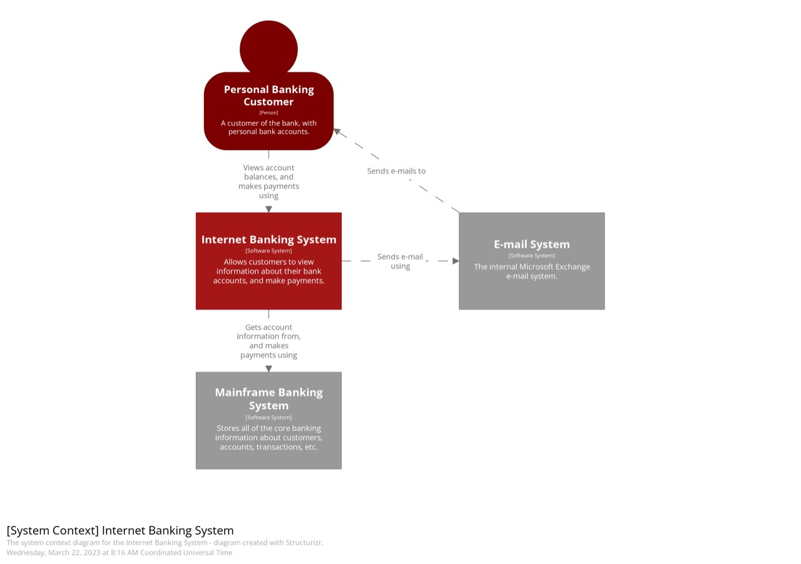
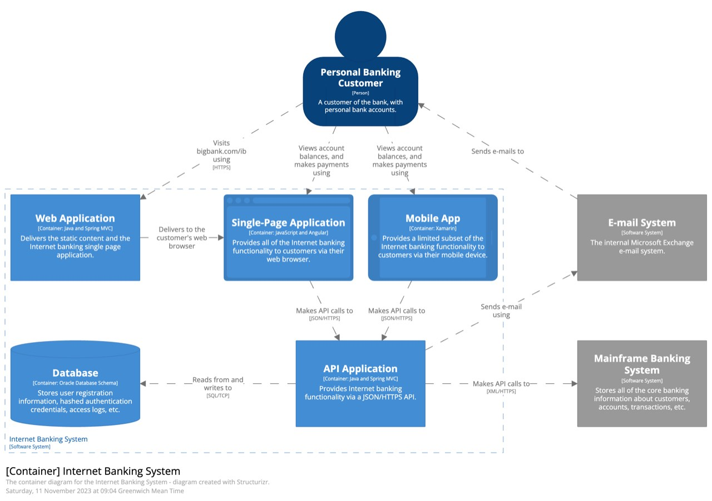
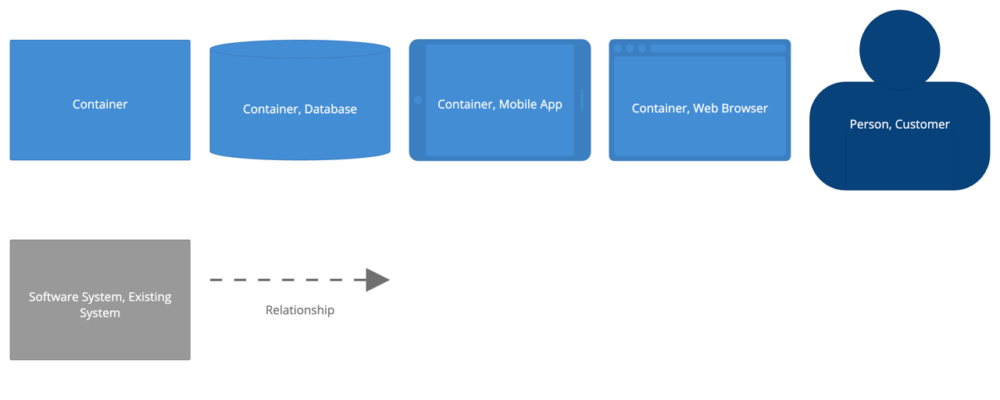
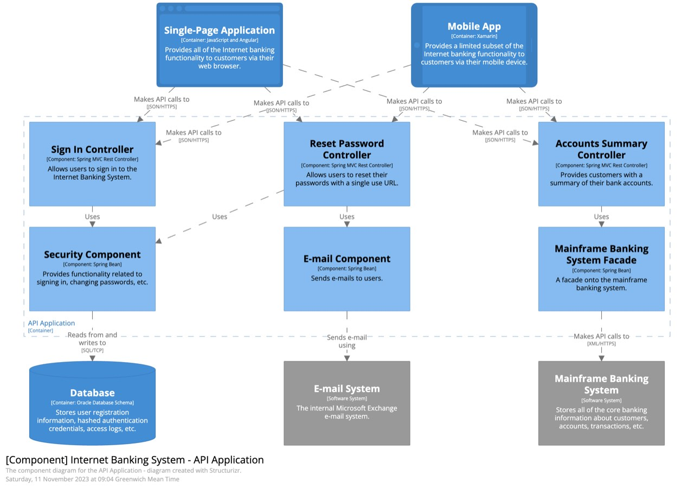
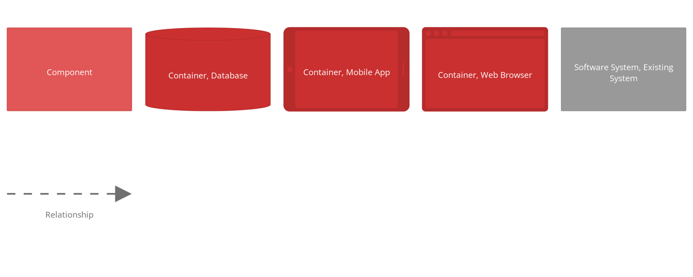
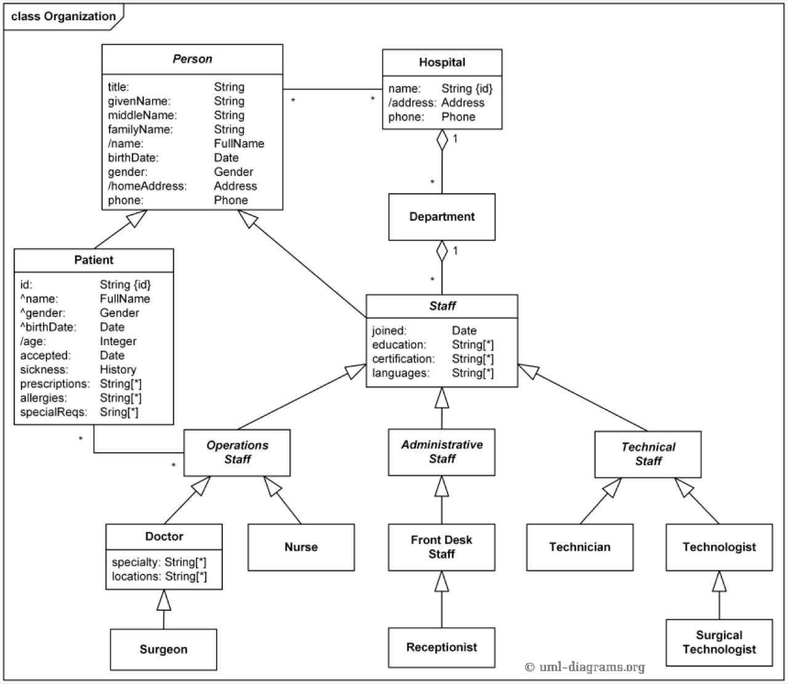
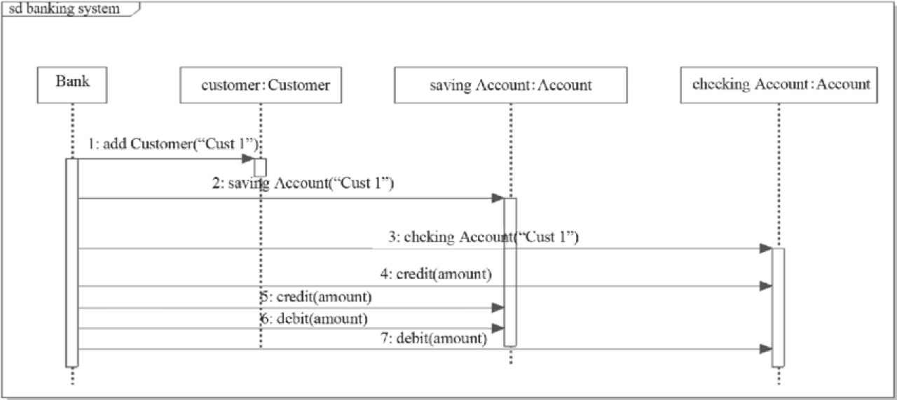
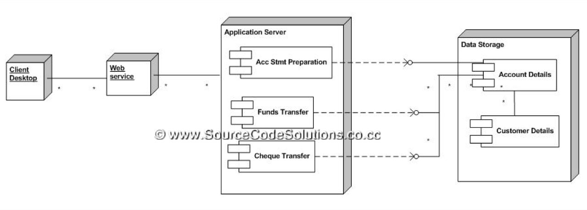
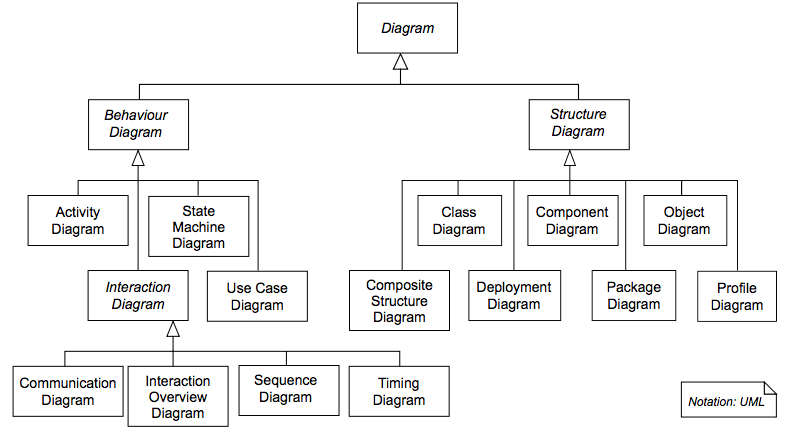
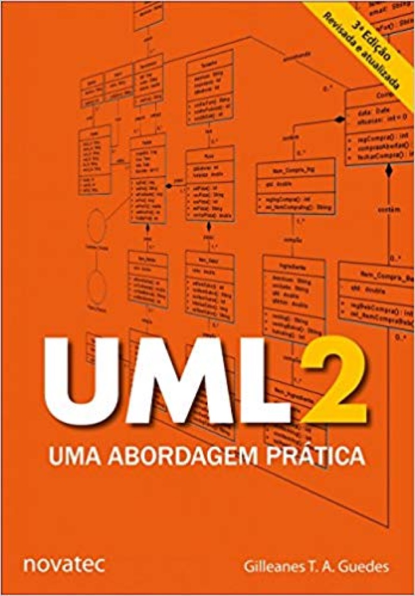

# ARQUITETURA_CLOUD_2-C4MODEL-UML

> Converted from `ARQUITETURA_CLOUD_2-C4MODEL-UML.pptx`.

## 1. Documentação para Arquitetura de Software e Soluções

C4 Model
UML

## 2. C4 Model

O C4 Model é uma abordagem para visualização da arquitetura de software, criada por Simon Brown. Ele fornece uma maneira estruturada de descrever sistemas de software através de um conjunto de abstrações e diagramas que ajudam equipes a alinhar decisões técnicas de forma mais rápida e clara.

- https://c4model.com/

## 3. Estrutura do C4 Model

Abstrações Hierárquicas: O modelo define quatro níveis de abstração que ajudam a descrever o sistema e seu ecossistema:
  - Pessoa: Representa os usuários finais que interagem com o sistema.
  - Sistema: O nível mais alto, que entrega valor aos usuários, podendo incluir sistemas externos.
  - Contêiner: Aplicações e armazenamentos de dados que compõem um sistema, sendo executáveis de forma independente.
  - Componente: Módulos que formam cada contêiner, como um módulo de autenticação ou um validador de cartão de pagamento.
  - *** Contêiner neste contexto não tem relação com Docker , Kubernetes, etc***

## 4. Pessoa

Uma pessoa representa um dos usuários humanos do seu sistema de software (por exemplo, atores, papéis, personas, etc.).

## 5. Sistema de software

Um sistema de software é o nível mais alto de abstração e descreve algo que agrega valor aos seus usuários.
  - normalmente usando termos como "aplicativo", "produto", "serviço", etc.

## 6. Contêiner

Aplicativo ou um armazenamento de dados. Um contêiner é algo que precisa estar em execução para que o sistema de software geral funcione. Em termos reais, um contêiner é algo como:
- Aplicativo da Web do lado do servidor: um aplicativo da Web Java EE em execução no Apache Tomcat, um aplicativo ASP.NET MVC em execução no Microsoft IIS, um aplicativo Ruby on Rails em execução no WEBrick, um aplicativo Node.js etc.
- Aplicativo Web do lado do cliente: um aplicativo JavaScript em execução em um navegador da Web usando Angular, Backbone.JS, jQuery etc.
- Aplicativo de desktop do lado do cliente: um aplicativo de desktop do Windows escrito usando WPF, um aplicativo de desktop do OS X escrito usando Objective-C, um aplicativo de desktop multiplataforma escrito usando JavaFX etc.
- Aplicativo móvel: um aplicativo Apple iOS, um aplicativo Android, um aplicativo Microsoft Windows Phone, etc.

## 7. Contêiner

- Aplicativo de console do lado do servidor: um aplicativo autônomo (por exemplo, um app console, um processo em lote, etc.
- Função sem servidor: uma única função sem servidor (por exemplo, Amazon Lambda, Azure Function etc.).
- Banco de dados: Um esquema ou banco de dados em um sistema de gerenciamento de banco de dados relacional, armazenamento de documentos, banco de dados gráfico, etc., como MySQL, Microsoft SQL Server, Oracle Database, MongoDB, Riak, Cassandra, Neo4j, etc.
- Armazenamento de blob ou conteúdo: um armazenamento de blobs (por exemplo, Amazon S3, Microsoft Azure Blob Storage etc.) ou rede de entrega de conteúdo (por exemplo, Akamai, Amazon CloudFront etc.).
- Sistema de arquivos: Um sistema de arquivos local completo ou uma parte de um sistema de arquivos em rede maior (por exemplo, SAN, NAS, etc.).
- Shell script: Um único script de shell escrito em Bash, etc.

## 8. Componente

Um componente é um conjunto de funcionalidades encapsuladas atrás de uma interface bem-definida.

## 9. Diagramas do C4 Model

O C4 Model utiliza quatro tipos de diagramas, cada um adequado a diferentes públicos e níveis de detalhe:
Diagrama de Contexto do Sistema (Nível 1): Oferece uma visão geral de como os usuários interagem com o sistema e outros sistemas externos.
Diagrama de Contêiner (Nível 2): Foca nos contêineres dentro de um sistema, mostrando como eles se comunicam.
Diagrama de Componente (Nível 3): Detalha os componentes dentro de um contêiner e suas interações.
Diagrama de Código (Nível 4): Geralmente na forma de diagramas de classe UML, mostrando a estrutura detalhada do código

## 10. (sem título)

## 11. Diagrama de contexto do sistema (Nível 1)

## 12. Diagrama de contêiner (Nível 2)

## 13. Diagrama de componentes (Nível 3)

## 14. Diagrama de código (Nível 4)

## 15. Importância do C4 Model

O C4 Model é especialmente útil para equipes de desenvolvimento, pois:
  - Facilita a comunicação: Ao fornecer uma linguagem comum para descrever a arquitetura, ele ajuda a eliminar mal-entendidos entre diferentes partes interessadas.
  - Aumenta a clareza: Os diagramas ajudam a visualizar as interações e a estrutura do sistema de forma clara e organizada.
  - Suporta diferentes públicos: Com níveis variados de detalhe, o modelo atende tanto a audiências técnicas quanto não técnicas, permitindo que todos os envolvidos compreendam a arquitetura do sistema.

## 16. Relembrando Diagramas UML

## 17. Referências

## 18. Exemplos

Banking Visual Paradigm
  - [C4 Model Deployment Diagram for Internet Banking System | Modelo C4 Template (visual-paradigm.com)](https://online.visual-paradigm.com/pt/diagrams/templates/c4-model/c4-model-deployment-diagram-for-internet-banking-system/)

## 19. Ferramentas

Mermaid (Free)
PlantUML (Free)
Draw.io (Web)
ICEPanel (Pago / Free)
ASTAH UML Community / Trial

## 20. Demonstração

Professor demonstrar o uso de Mermaid , C4 Model, Draw.io

## 21. Atividade Entrega Ava

Equipe 4 alunos (Mesma equipe para as demais atividades).
Definir um sistema, produto, aplicativo (Mesmo sistema para demais atividades).
  - Criar diagrama Nível 1.
  - Criar diagrama Nível 2.
  - (Opcional) Criar diagrama Nível 3.
  - (Opcional) Criar diagrama Nível 4 (Recomendo: Utilizar apenas o diagrama de classes, sequência, deployment e componentes da UML).
    - Os Níveis (3,4) marcados como opcional serão trabalhados após “estilos e padrões arquiteturais”.
Publicar no AVA, arquivo Markdown com o diagrama.
Informar os integrantes do grupo.

## 22. Atividade – Pré TDE

Equipe 4 alunos (Mesma equipe para as demais atividades).
  - Requisitos Funcionais Primeira Aula
    - Criar Tabela com Identificador e Descrição).
    - Descrever o que o sistema.
  - Iniciar elaboração diagramas C4 Model ( Level 1 e Level 2)
