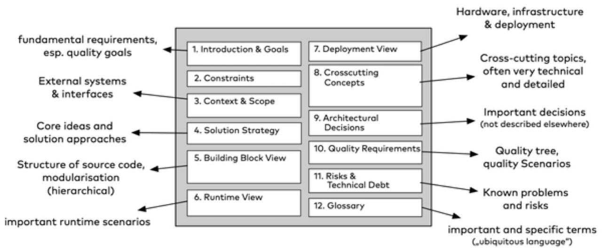
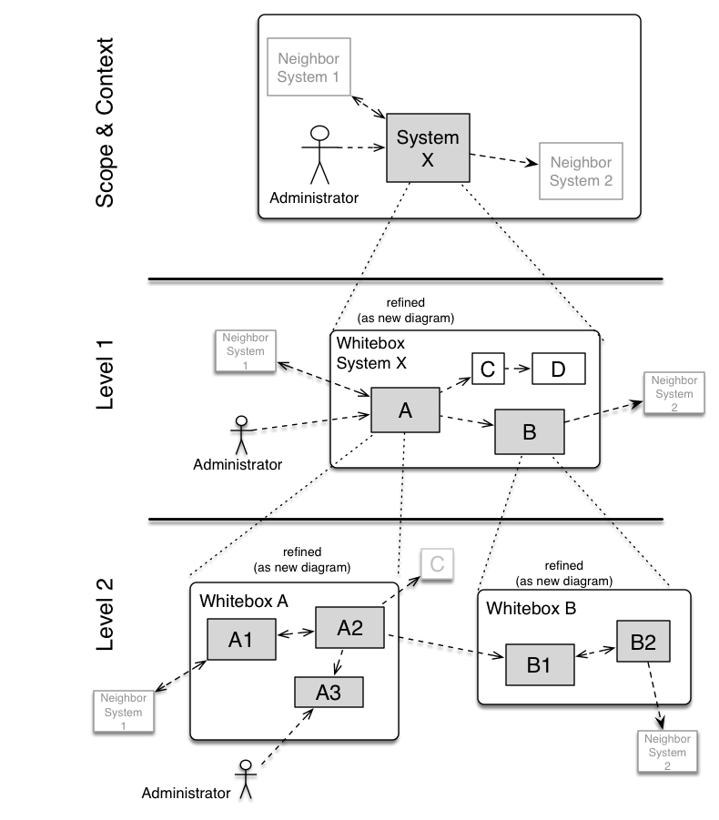
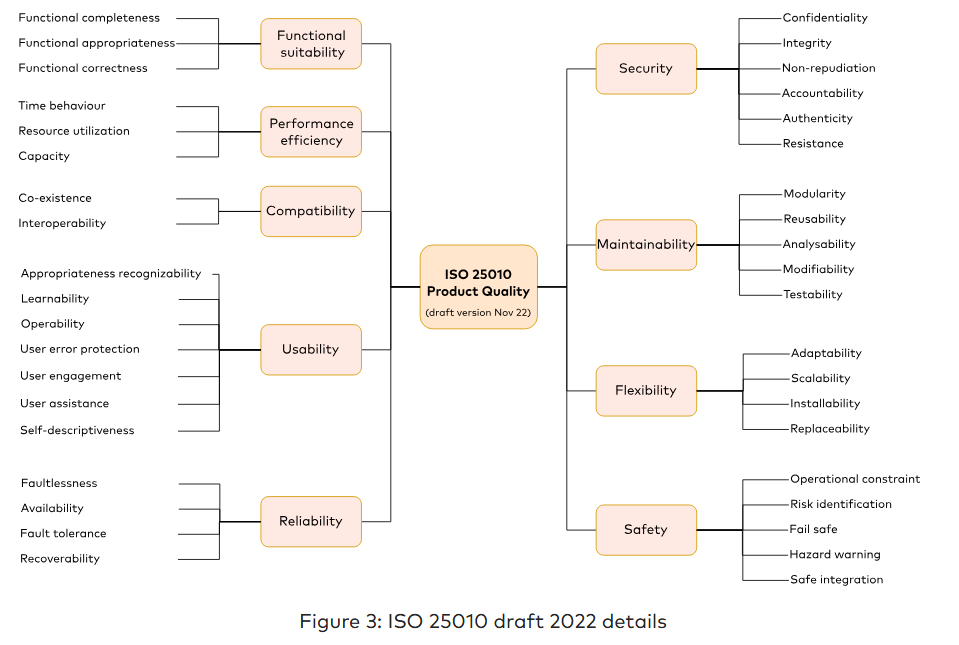
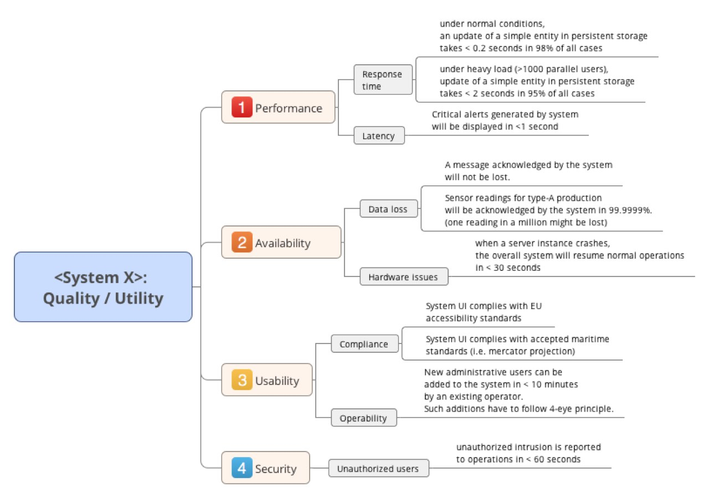
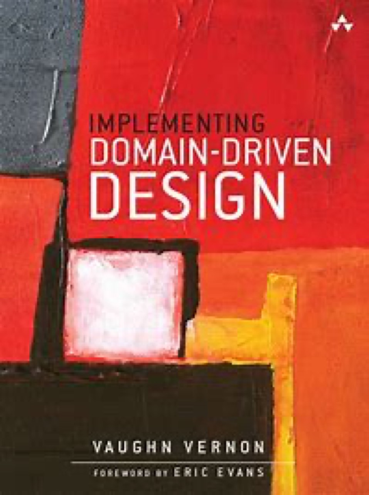
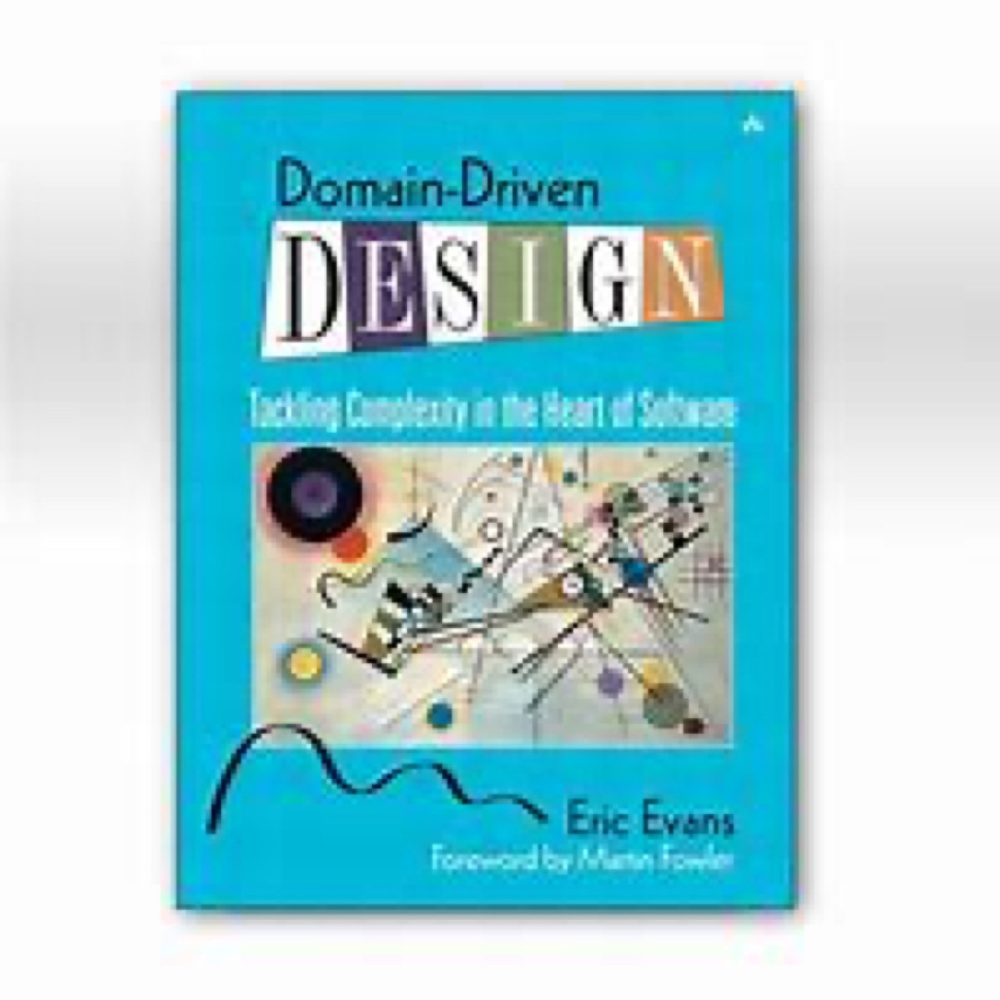
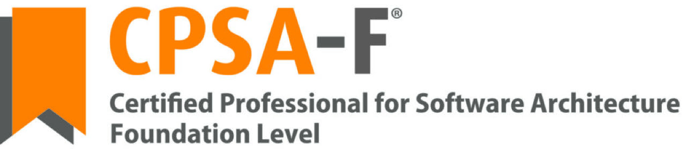

# ARQUITETURA_CLOUD_3-ARCH42

> Converted from `ARQUITETURA_CLOUD_3-ARCH42.pptx`.

## 1. Arc42

Arc42 é um modelo e template para documentação e comunicação de arquiteturas de software e sistemas. Desenvolvido para ser prático e flexível, o arc42 é uma abordagem open-source que permite que equipes de desenvolvimento documentem suas decisões arquiteturais de forma eficaz e compreensível.

[arc42 Examples - arc42](https://arc42.org/examples)

## 2. Arc42

O Arc42 foi criado por dois profissionais de software, Dr. Gernot Starke e Dr. Peter Hruschka.
Gernot Starke é um renomado arquiteto de software e consultor com muitos anos de experiência na indústria de software. Publicações: Ele é autor de vários livros e artigos sobre arquitetura de software, e é amplamente reconhecido por suas contribuições à documentação e comunicação de arquitetura.
Peter Hruschka é também um arquiteto de software experiente e consultor. Ele tem uma vasta experiência em métodos ágeis e documentação de arquitetura. Contribuições: Além de co-criar o Arc42, ele também é autor e coautor de vários livros sobre arquitetura de software e métodos ágeis.

[Dr. Gernot Starke - Dr. Gernot Starke, INNOQ Fellow](https://www.gernotstarke.de/)

[Peter HRUSCHKA | Principal | Dipl.-Ing. Dr. | Research profile (researchgate.net)](https://www.researchgate.net/profile/Peter-Hruschka)

## 3. Principais Características do arc42

- Estrutura de Documentação:  Arc42 fornece uma estrutura clara para a documentação da arquitetura, organizando a informação em seções específicas que cobrem diferentes aspectos do sistema, como visão geral do sistema, contexto, restrições, visão de construção, visão de execução, etc.
- Independente de Métodos:  Arc42 é independente de métodos específicos de desenvolvimento de software, o que significa que pode ser usado em projetos ágeis, tradicionais ou qualquer outra metodologia.
- Suporte a Diversos Níveis de Detalhe:  A estrutura do Arc42 permite que a documentação seja feita em diferentes níveis de detalhe, desde uma visão geral de alto nível até detalhes técnicos mais profundos.
- Foco na Comunicação:  Um dos principais objetivos do Arc42 é melhorar a comunicação entre os diferentes stakeholders do projeto, garantindo que todos tenham uma compreensão clara da arquitetura do sistema.
- Princípios:  Arc42 é baseado em princípios práticos e orientados à aplicação, focando na criação de documentação útil e relevante, em vez de apenas criar documentação por obrigação.
- Flexibilidade:  Ele é flexível o suficiente para ser adaptado às necessidades específicas do projeto e da equipe, permitindo que os arquitetos escolham as partes mais relevantes do framework para seu contexto específico.

## 4. (sem título)

## 5. Estrutura do Arc42

- Introdução e Metas
- Visão Geral das Regras e Restrições
- Visão de Contexto
- Visão de Solução
- Construção
- Visão de Execução
- Conceitos de Implementação
- Crosscutting Concepts
- Decisões de Arquitetura
- Qualidade
- Visão de Riscos e Problemas Técnicos
- Glossário

## 6. Estrutura do Arc42

1.Introdução e Metas
Descreve os requisitos relevantes e as forças motrizes que os arquitetos de software e a equipe de desenvolvimento devem considerar. Esses incluem objetivos de negócios subjacentes, recursos essenciais e requisitos funcionais para o sistema, metas de qualidade para a arquitetura, partes interessadas relevantes e suas expectativas

## 7. Estrutura do Arc42

2.Visão Geral das Regras e Restrições
Qualquer requisito que restrinja os arquitetos de software em sua liberdade de decisões de design e implementação ou decisão sobre o processo de desenvolvimento. Essas restrições às vezes vão além dos sistemas individuais e são válidas para organizações e empresas inteiras.

## 8. Estrutura do Arc42

3. Visão de Contexto
O escopo e o contexto do sistema delimitam seu sistema (ou seja, seu escopo) de todos os seus parceiros de comunicação (sistemas e usuários vizinhos, ou seja, o contexto do seu sistema). Assim, ele especifica as interfaces externas.
Se necessário, diferencie o contexto de negócios (entradas e saídas específicas do domínio) do contexto técnico (canais, protocolos, hardware).

## 9. Estrutura do Arc42

4. Visão de Solução
Um breve resumo e explicação das decisões fundamentais e estratégias de solução que moldam a arquitetura do sistema. Esses incluem:
decisões de tecnologia
decisões sobre a decomposição de nível superior do sistema, por exemplo, uso de um padrão arquitetônico ou padrão de design
decisões sobre como atingir as principais metas de qualidade
decisões organizacionais relevantes, por exemplo, selecionar um processo de desenvolvimento ou delegar certas tarefas a terceiros.

## 10. Estrutura do Arc42

5. Construção
A visualização de blocos de construção mostra a decomposição estática do sistema em blocos de construção (módulos, componentes, subsistemas, classes, interfaces, pacotes, bibliotecas, frameworks, camadas, partições, camadas, funções, macros, operações, estruturas de dados, ...) bem como suas dependências (relacionamentos, associações, ...)

## 11. Estrutura do Arc42

5. Construção

## 12. Estrutura do Arc42

6. Visão de Execução
A visualização de tempo de execução descreve o comportamento concreto e as interações dos blocos de construção do sistema na forma de cenários das seguintes áreas:
Casos de uso ou recursos importantes: como os blocos de construção os executam?
Interações em interfaces externas críticas: como os blocos de construção cooperam com usuários e sistemas vizinhos?
Operação e administração: lançamento, inicialização, parada
Cenários de erro e exceção

## 13. Estrutura do Arc42

7. Conceitos de Implementação
A visualização de implantação descreve:
a infraestrutura técnica usada para executar seu sistema, com elementos de infraestrutura como localizações geográficas, ambientes, computadores, processadores, canais e topologias de rede, bem como outros elementos de infraestrutura e
o mapeamento de blocos de construção (de software) para esses elementos de infraestrutura.
Documente especialmente a visualização de implantação quando seu software for executado como sistema distribuído com mais de um computador, processador, servidor ou contêiner ou quando você projeta e constrói seus próprios processadores de hardware.

## 14. Estrutura do Arc42

8. Crosscutting Concepts
Esta seção descreve os principais regulamentos gerais e ideias de soluções que são relevantes em várias partes (→ transversais) do seu sistema. Esses conceitos geralmente estão relacionados a vários blocos de construção. Eles incluem muitos tópicos diferentes, como
Modelos de domínio
Padrões e estilos arquiteturais ou padrões de design
Regras para uso de tecnologia específica, muitas vezes decisões técnicas de decisões gerais
Regras de execução

## 15. Estrutura do Arc42

9. Decisões de Arquitetura
Decisões de arquitetura importantes
Documentar o julgamento para decidir se uma decisão arquitetônica deve ser documentada aqui nesta seção central ou se é melhor documentá-la localmente (por exemplo, dentro do modelo de caixa branca de um bloco de construção)

[adr.github.io](https://adr.github.io/)

[joelparkerhenderson/architecture-decision-record: Architecture decision record (ADR) examples for software planning, IT leadership, and template documentation (github.com)](https://github.com/joelparkerhenderson/architecture-decision-record)

## 16. Estrutura do Arc42

9. Decisões de Arquitetura

| Secção | Descrição |
|---|---|
| Título | As decisões devem ter um nome próprio. Por exemplo, "ADR 42: Padrão de estratégia para vários algoritmos de verificação" ou "ADR 9: Keycloak para gerenciamento de segredos" |
| Contexto | Descreva a situação, incluindo aspectos técnicos, políticos, sociais e do projeto. Essas forças podem estar em tensão. |
| Decisão | Qual é a nossa decisão (responder às forças descritas no contexto) |
| Estado | Uma decisão pode ser "proposta" se as partes interessadas importantes ainda não concordarem com ela, ou "aceita" uma vez acordada. Também poderia ser "obsoleto" ou "substituído", esperançosamente com uma referência à sua substituição. |
| Consequências | O que vai ou pode acontecer como consequência dessa decisão. Todas as consequências devem ser listadas aqui, não apenas as "positivas". Uma determinada decisão pode ter consequências positivas, negativas e neutras, mas todas elas afetam a equipe e o projeto no futuro. |

## 17. Estrutura do Arc42

10. Qualidade
Esta seção contém todos os requisitos de qualidade como árvore de qualidade com cenários. Os mais importantes já foram descritos na secção 1.2. (metas de qualidade)
Capturar os requisitos de qualidade com menor prioridade, que não criarão riscos elevados quando não forem plenamente alcançados.

## 18. Estrutura do Arc42

10. Qualidade

## 19. Estrutura do Arc42

10. Qualidade

A tabela ou árvore (conforme definido no ATAM – Método de Análise de Tradeoff de Arquitetura) de requisitos de qualidade, com cenários de qualidade/avaliação como folhas.

## 20. Estrutura do Arc42

10. Qualidade

| Categoria de qualidade | Qualidade | Descrição | Cenário |
|---|---|---|---|
| Usabilidade | Facilidade de uso (3) | Facilidade de uso pelo policial, especialmente no caso de uso de perseguir outro carro |  |
|  | Facilidade de Aprendizagem | As funções padrão devem ser tão fáceis e intuitivas de usar quanto possível, sem a necessidade de longas instruções prévias | SC1 |
| Desempenho | Precisão (1) | As medições e os cálculos devem ser corretos e precisos dentro da faixa de desvio especificada |  |
|  | Abrangência | Os algoritmos utilizados devem ser tão estanques quanto possível e compreensíveis |  |
|  | Precisão & Exatidão | Se possível, as inserções de vídeo devem ser feitas com a granularidade de um quadro de vídeo |  |
|  | Robustez (2) | O sistema deve funcionar de forma fiável em todos os ambientes e condições de funcionamento especificados. |  |

## 21. Cenários de Qualidade

| Id | Cenário |
|---|---|
| SC1 | Um usuário que não conhece o sistema pode operá-lo após 10 minutos de instrução |
| SC2 | Ao reproduzir um vídeo quadro a quadro posteriormente, cada quadro contém exatamente as informações esperadas |
| SC3 | Mesmo sob temperatura máxima e mínima (por exemplo, em uma câmara climática), o dispositivo sempre emite a mesma velocidade em frequência de pulso constante. |
| SC4 | Com os arquivos de tradução apropriados substituindo o idioma padrão (inglês), todos os textos exibidos e impressos agora aparecem nesse idioma. |

## 22. Estrutura do Arc42

11. Visão de Riscos e Dívidas Técnicas
Uma lista de riscos técnicos ou dívidas técnicas identificados, ordenados por prioridade.

## 23. Estrutura do Arc42

12. Glossário
O domínio mais importante e os termos técnicos que suas partes interessadas usam ao discutir o sistema.
O glossário como fonte de traduções se trabalhar em um ambiente multilíngue (ou seja, em modelos de desenvolvimento offshore).

[Developing the ubiquitous language - DDD - The Domain Driven Design](https://thedomaindrivendesign.io/developing-the-ubiquitous-language/)

| Prazo | Definição |
|---|---|
| &lt;Termo-1&gt; | &lt;definição-1&gt; |
| &lt;Termo 2&gt; | &lt;definição-2&gt; |

## 24. Arc42 x C4 Model

Diagrama de Contexto: Seção 3 - Visão de Contexto
Diagrama de Containers: Seção 4 - Visão de Solução
Diagrama de Componentes: Seção 5 - Visão de Construção
Diagrama de Código: Seção 6 - Conceitos de Implementação

## 25. Exemplos

Detalhes e dicas sobre como implementar cada tópico:
  - [Home | arc42 Documentation](https://docs.arc42.org/home/)
Biking (Um exemplo do mundo real para um rastreador de atividades de bicicleta)
  - [biking2, Architecture and API (michael-simons.eu)](https://biking.michael-simons.eu/docs/index.html)
Livro
  - [arc42 by… by Gernot Starke et al. [Leanpub PDF/iPad/Kindle]](https://leanpub.com/arc42byexample)

## 26. Certificação

[iSAQB CPSA Software Architecture Training | Foundation Level (CPSA-F)](https://www.isaqb.org/certifications/cpsa-certifications/cpsa-foundation-level/)
[Exame CPSA-FL » ACerT - Academia Brasileira de Certificações e Treinamentos (acertbr.com.br)](https://acertbr.com.br/exame-cpsa-fl/) 697,00. Estudante paga meia.
- Duração: 1h15min. (75 min.)
- Não nativos: 1h30min. (90 min.)
- Modalidade:  on-line para todo o Brasil
- Idioma:  Português ou Inglês
- Questões: Múltipla escolha (44 questões)
- Pontuação: 1 a 2 pontos conforme o grau de dificuldade da questão
- Acertos: 60%
- Resultado:  Em até 1 semana
- Pedido de revisão do exame: R$ 100,00

## 27. Atividade

Em equipe documentar: seção 1, 2 e 3
Criar arquivo Markdown (MeuSistema.md). (Ver template no site do Arc42)
Para os diagramas utilizar mermaid.
Utilizar os diagramas C4 Model Level 1 e 2.
No AVA fornecer o Arquivo MarkDown.
No arquivo deve constar uma seção com os nomes dos alunos.
Exemplo
[https://biking.michael-simons.eu/docs/index.htmlLinks to an external site.](https://biking.michael-simons.eu/docs/index.html)
A não entrega da tarefa impede o aluno de realizar a prova de recuperação do RA.
