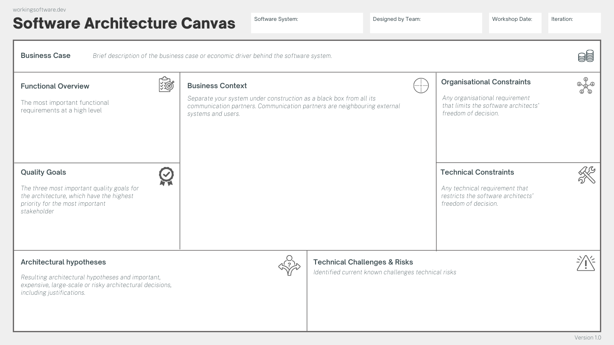
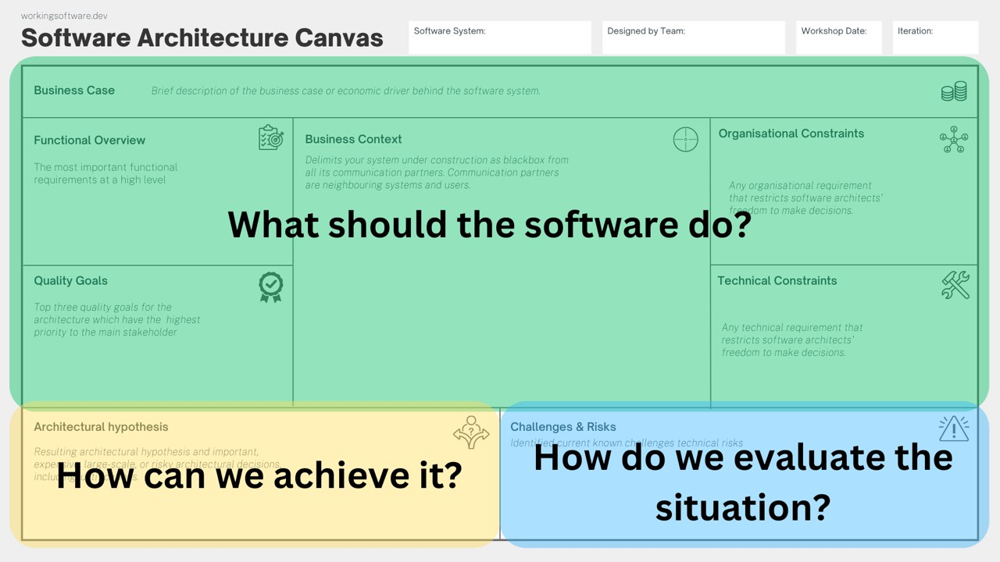
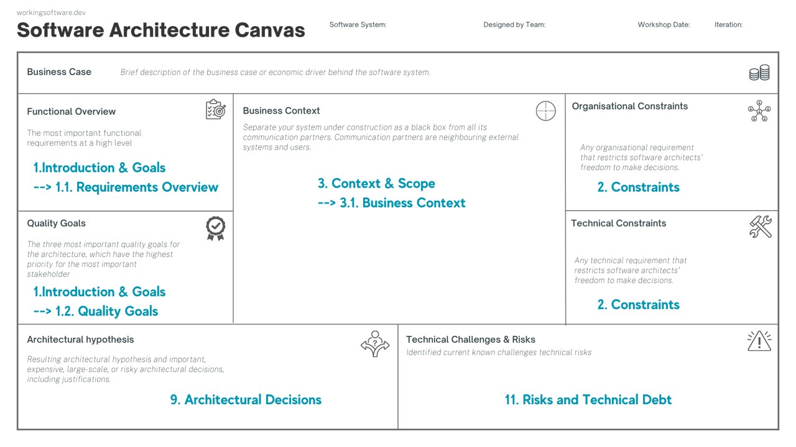
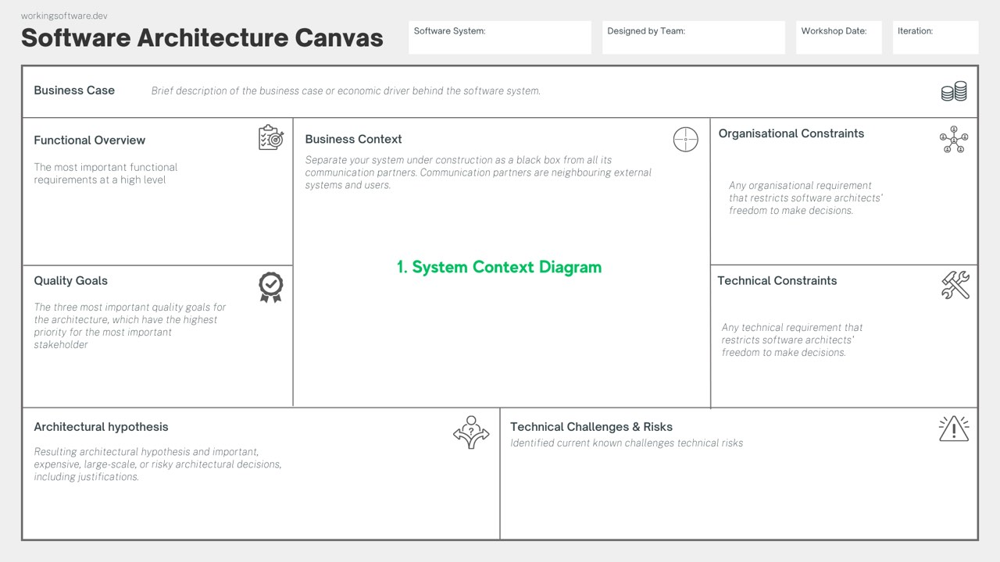

# ARQUITETURA_CLOUD_4-CANVAS

> Converted from `ARQUITETURA_CLOUD_4-CANVAS.pptx`.

## 1. Software Architecture Canvas

Curso: Bacharelado em Engenharia de Software
Disciplina: Arquitetura de Soluções com Cloud
Prof: Manoel Valerio da Silveira Neto
2/2026

## 2. Software Architecture Canvas

[Download Canvas - Software Architecture Canvas (arc42.org)](https://canvas.arc42.org/downloads)

[Software Architecture Canvas - Software Architecture Canvas (arc42.org)](https://canvas.arc42.org/)

## 3. Software Architecture Canvas

## 4. Software Architecture Canvas

O Software Architecture Canvas é dividido em três partes:
- Objetivos: O que o software deve fazer? (verde)
- Solução: Como podemos alcançá-lo? (amarelo)
- Avaliação: Como avaliamos a situação? (azul)

## 5. Software Architecture Canvas x Arch42

## 6. Software Architecture Canvas x Arch42

- Functional Overview ➡️ [1. Introduction & Goals](https://docs.arc42.org/section-1/?ref=workingsoftware.dev) (1.1. Requirements Overview)
- Quality Goals ➡️ [1. Introduction & Goals](https://docs.arc42.org/section-1/?ref=workingsoftware.dev) (1.2. Quality Goals)
- Business Context ➡️ [3. Context & Scope](https://docs.arc42.org/section-3/?ref=workingsoftware.dev) (3.1 Business Context)
- Organisational Constraints ➡️ [2. Constraints](https://docs.arc42.org/section-2/?ref=workingsoftware.dev)
- Technical Contraints ➡️ [2. Constraints](https://docs.arc42.org/section-2/?ref=workingsoftware.dev)
- Architectural hypothesis ➡️ [9. Architectural Decisions](https://docs.arc42.org/section-9/?ref=workingsoftware.dev)
- Technical Challenges & Risks ➡️ [11. Risks and Technical Debt](https://docs.arc42.org/section-11/?ref=workingsoftware.dev)

## 7. Software Architecture Canvas x C4 Model

