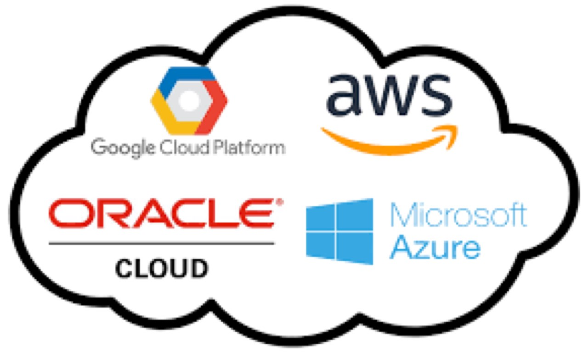
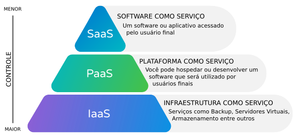
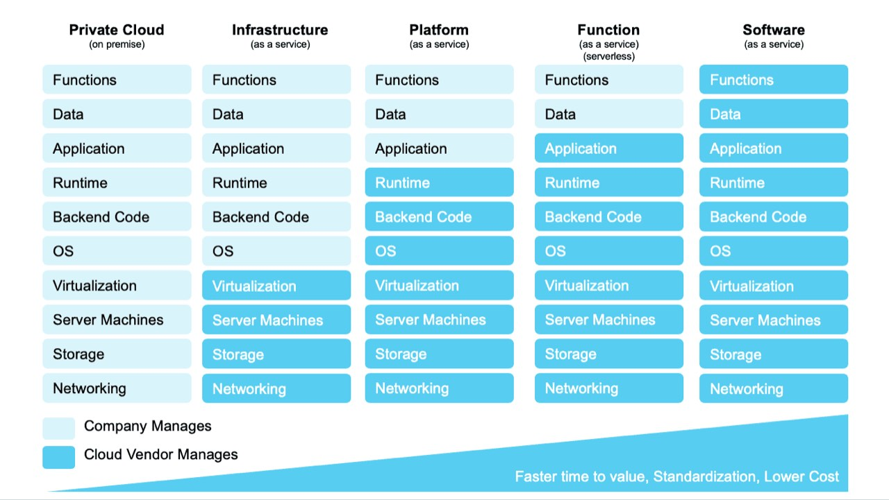
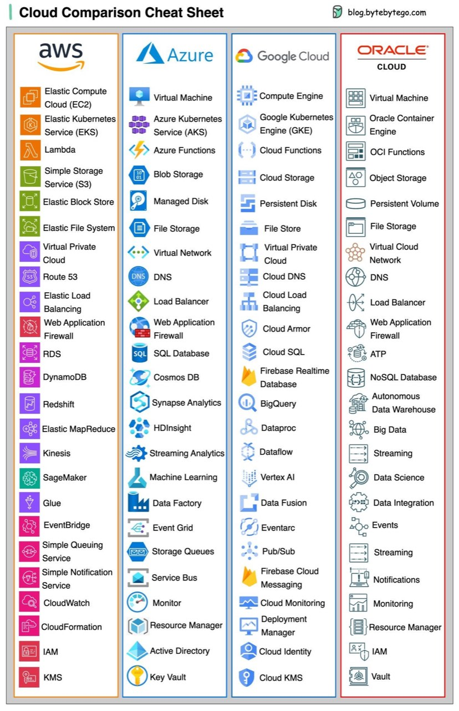

# ARQUITETURA_CLOUD_5-Fundamentos de Computação em Nuvem

> Converted from `ARQUITETURA_CLOUD_5-Fundamentos de Computação em Nuvem.pptx`.

## 1. Fundamentos de Computação em Nuvem

Professor Manoel Valerio da Silveira Neto

## 2. Agenda

- 1-   Introdução à Computação em Nuvem
- 2 - Modelos de Serviço em Nuvem
- 3 - Arquitetura de Computação em Nuvem
- 4 - Segurança na Nuvem
- 5 - Gerenciamento e Governança em Nuvem
- 6 - Tendências e Tecnologias Emergentes
- 7 - Casos de Uso e Aplicações
- 8 - Desafios e Futuro da Computação em Nuvem

## 3. 1-  Introdução à Computação em Nuvem

- O Que é Computação em Nuvem?
- Definição:
  - Computação em nuvem é a entrega de serviços de computação (servidores, armazenamento, banco de dados, rede, software) pela internet ("a nuvem").
- Principais Características:
  - Acesso sob demanda.
  - Escalabilidade.
  - Pagamento conforme o uso.

## 4. 1-  Introdução à Computação em Nuvem

- História e Evolução da Computação em Nuvem
- Linha do Tempo:
  - Década de 1960:  Conceito de "computação utilitária" proposto por John McCarthy.
  - Década de 1990:  A popularização da internet e do modelo ASP (Application Service  Provider ).
  - 2006:  Lançamento do Amazon Web Services (AWS).
- Impacto: Mudança de paradigmas na forma de consumir recursos de TI.

## 5. 1-  Introdução à Computação em Nuvem

- Principais Conceitos de Computação em Nuvem
- Elasticidade:
  - Capacidade de expandir ou reduzir recursos conforme a demanda.
- Multi-Tenancy:
  - Vários usuários compartilham os mesmos recursos físicos, mas de forma isolada.
- Virtualização:
  - Criação de recursos virtuais, como servidores ou redes, a partir de recursos físicos.
- Disponibilidade e Resiliência:
  - A nuvem garante alta disponibilidade e recuperação rápida em caso de falhas.

## 6. 1-  Introdução à Computação em Nuvem

- Tipos de Nuvens
- Nuvem Pública:
  - Propriedade de provedores de serviços (ex.: AWS, Azure, Oracle, GCP).
  - Serviços acessíveis ao público em geral.
- Nuvem Privada:
  - Infraestrutura exclusiva de uma organização.
  - Maior controle e segurança.
- Nuvem Híbrida:
  - Combinação de nuvem pública e privada.
  - Flexibilidade para escalar conforme a necessidade.
- Nuvem Comunitária:
  - Compartilhada entre várias organizações com interesses comuns.
  - Ex.: Governo, saúde, finanças.

## 7. 1-  Introdução à Computação em Nuvem

- Vantagens da Computação em Nuvem
- Redução de Custos:
  - Menor investimento inicial em hardware e infraestrutura.
- Escalabilidade:
  - Ajuste automático de recursos de acordo com a demanda.
- Flexibilidade:
  - Acesso a recursos de qualquer lugar e a qualquer hora.
- Manutenção Simplificada:
  - Atualizações e gerenciamento feitos pelo provedor de serviços.

## 8. 1-  Introdução à Computação em Nuvem

- Desafios da Computação em Nuvem
- Segurança:
  - Proteção de dados e conformidade com regulamentações.
- Dependência do Provedor:
  - Risco de "lock-in" com um único provedor.
- Latência e Desempenho:
  - Dependência da conexão com a internet.
- Gerenciamento de Custos:
  - Monitoramento e controle dos gastos em ambientes de nuvem.

## 9. 1-  Introdução à Computação em Nuvem

- Conclusão
- Resumo:
  - A computação em nuvem revolucionou a forma como as empresas acessam e utilizam recursos de TI.
  - Compreender os conceitos fundamentais é crucial para aproveitar ao máximo as vantagens da nuvem.
- Próximos Passos:
  - Exploração dos modelos de serviço em nuvem (IaaS, PaaS, SaaS).

## 10. 2 - Visão Geral dos Modelos de Serviço em Nuvem

- Definição:
- Explicação dos três principais modelos de serviço: IaaS, PaaS e SaaS.
- Comparação Geral:
- Quem gerencia o quê em cada modelo (usuário vs. provedor).

## 11. 2 - Visão Geral dos Modelos de Serviço em Nuvem

## 12. 2 - Visão Geral dos Modelos de Serviço em Nuvem

- Infrastructure as a Service (IaaS)
- O que é IaaS:
  - Fornecimento de infraestrutura de TI virtualizada (servidores, armazenamento, redes) sob demanda.
- Principais Características:
  - Acesso a recursos de computação como serviço.
  - Controle total sobre a infraestrutura.
  - Paga-se apenas pelo que é usado.
- Exemplos de IaaS:
  - Amazon Web Services (AWS EC2), Microsoft Azure, Google Compute Engine.
- Vantagens:
  - Flexibilidade, escalabilidade e custo-benefício.
- Desafios:
  - Gerenciamento complexo, segurança e necessidade de especialização técnica.

## 13. 2 - Visão Geral dos Modelos de Serviço em Nuvem

- Platform as a Service (PaaS)
- O que é PaaS:
  - Fornecimento de uma plataforma para desenvolvimento, teste e implantação de aplicativos.
- Principais Características:
  - Ambiente de desenvolvimento completo, com ferramentas e serviços integrados.
  - O provedor gerencia a infraestrutura subjacente.
  - Suporte a linguagens e frameworks específicos.
- Exemplos de PaaS:
  - Google App Engine, Microsoft Azure App Services, Heroku.
- Vantagens:
  - Acelera o desenvolvimento, reduz a complexidade da infraestrutura.
- Desafios:
  - Menor controle sobre a infraestrutura, possível dependência de fornecedor (lock-in).

## 14. 2 - Visão Geral dos Modelos de Serviço em Nuvem

- Software as a Service (SaaS)
- O que é SaaS:
  - Fornecimento de software através da internet como um serviço, acessível via navegador.
- Principais Características:
  - Aplicações hospedadas e gerenciadas pelo provedor.
  - Pagamento por assinatura ou uso.
  - Sem necessidade de instalação ou manutenção local.
- Exemplos de SaaS:
  - Google Workspace, Salesforce, Microsoft 365.
- Vantagens:
  - Facilidade de acesso, manutenção mínima, atualização contínua.
- Desafios:
  - Personalização limitada, preocupações com a segurança de dados.

## 15. 2 - Visão Geral dos Modelos de Serviço em Nuvem

- Comparação entre IaaS, PaaS e SaaS
- Tabela Comparativa:
  - Controle:  Maior no IaaS, menor no SaaS.
  - Escalabilidade:  Alta em todos, mas com diferentes responsabilidades.
  - Flexibilidade:  IaaS oferece a maior flexibilidade; SaaS a menor.
  - Gerenciamento:  IaaS requer mais gerenciamento por parte do usuário; SaaS é completamente gerenciado pelo provedor.
- Diagrama Visual:
  - Um gráfico que mostre o nível de controle do usuário versus o nível de serviço gerenciado pelo provedor.

## 16. 2 - Visão Geral dos Modelos de Serviço em Nuvem

- Casos de Uso dos Modelos de Serviço
- IaaS:
  - Empresas que precisam de controle total sobre a infraestrutura, como startups tecnológicas.
- PaaS:
  - Desenvolvedores que precisam de um ambiente de desenvolvimento rápido e ágil.
- SaaS:
  - Organizações que buscam minimizar a gestão de software e focar no uso do produto.
- Exemplos Práticos:
  - Projetos de big data em IaaS, desenvolvimento ágil em PaaS, gestão de CRM em SaaS.

## 17. 2 - Visão Geral dos Modelos de Serviço em Nuvem

- Considerações na Escolha do Modelo
- Critérios de Escolha:
  - Necessidades de controle e customização.
  - Custo e orçamento disponível.
  - Necessidade de escalabilidade.
  - Habilidades técnicas da equipe.
- Recomendações:
  - Começar com SaaS para soluções comuns, considerar PaaS para desenvolvimento customizado e IaaS para infraestrutura complexa.

## 18. 2 - Visão Geral dos Modelos de Serviço em Nuvem

- Conclusão
  - Resumo:
    - IaaS, PaaS e SaaS são os pilares da computação em nuvem, cada um atendendo a diferentes necessidades e níveis de controle.
  - Mensagem Final:
    - Compreender as diferenças entre esses modelos é essencial para escolher a solução de nuvem mais adequada para cada situação.

## 19. 3 - Arquitetura de Computação em Nuvem

Visão Geral da Arquitetura de Computação em Nuvem
- Introdução:
  - Arquitetura de computação em nuvem envolve a integração de componentes tecnológicos e práticas para fornecer serviços de TI via internet.
- Objetivo:
  - Oferecer uma visão geral dos principais componentes e conceitos que sustentam a computação em nuvem.

## 20. 3 - Arquitetura de Computação em Nuvem

- Componentes Principais - Servidores
- Definição:
  - Servidores físicos e virtuais que processam e armazenam dados e aplicativos.
- Função na Nuvem:
  - Servidores são o coração da infraestrutura de nuvem, hospedando os serviços que os usuários acessam remotamente.
- Tipos de Servidores:
  - Bare Metal:  Servidores físicos dedicados.
  - Servidores Virtuais:  Criados através da virtualização, oferecendo flexibilidade e escalabilidade.
- Exemplo:
  - AWS EC2, Microsoft Azure VMs.

## 21. 3 - Arquitetura de Computação em Nuvem

- Componentes Principais - Armazenamento
- Definição:
  - Serviços que armazenam dados e arquivos acessíveis via internet.
- Tipos de Armazenamento:
  - Bloco:  Similar a discos rígidos, usados para sistemas operacionais e aplicativos.
  - Objeto:  Armazenamento de dados não estruturados, como arquivos multimídia.
  - Arquivo:  Sistemas de arquivo na nuvem, acessíveis por múltiplos usuários.
- Exemplos:
  - Amazon S3 (objeto), Google Cloud Storage (arquivo), Azure Blob Storage (bloco).
- Importância:
  - Armazenamento escalável e seguro é essencial para suportar aplicativos e dados em ambientes de nuvem.

## 22. 3 - Arquitetura de Computação em Nuvem

- Componentes Principais - Redes
- Definição:
  - Infraestrutura de rede que conecta servidores e dispositivos de armazenamento para disponibilizar serviços na nuvem.
- Elementos-Chave:
  - Load Balancers:  Distribuem o tráfego de rede para otimizar o desempenho.
  - Firewalls Virtuais:  Protegem os recursos contra acessos não autorizados.
  - VPC (Virtual Private Cloud):  Redes virtuais isoladas dentro da nuvem pública.
- Exemplos:
  - AWS VPC, Azure Virtual Network.
- Importância:
  - Redes robustas garantem conectividade confiável e segura entre os componentes da nuvem.

## 23. 3 - Arquitetura de Computação em Nuvem

- Virtualização e Containers
- Virtualização:
  - Definição:  Técnica que permite a criação de versões virtuais de recursos físicos, como servidores, através de hypervisores.
  - Função:  Maximiza a utilização de recursos físicos, permite a execução de múltiplos sistemas operacionais em uma única máquina.
  - Exemplos de Hypervisores:  VMware, Hyper-V, KVM.
- Containers:
  - Definição:  Uma forma de virtualização leve que empacota aplicativos e suas dependências em um único contêiner.
  - Vantagens:  Portabilidade, consistência entre ambientes de desenvolvimento e produção, inicialização rápida.
  - Exemplos de Plataformas de Containers:  Docker, Kubernetes.
- Comparação:
  - Virtual Machines:  Isolamento completo, mais pesado.
  - Containers:  Menos isolamento, mas mais eficientes e leves.
  - garantem conectividade confiável e segura entre os componentes da nuvem.

## 24. 3 - Arquitetura de Computação em Nuvem

- Multi-Tenancy e Escalabilidade
- Multi-Tenancy:
  - Definição:  Um modelo de arquitetura onde múltiplos usuários (tenants) compartilham os mesmos recursos de computação, mas com dados e operações isolados.
  - Vantagens:  Redução de custos operacionais, eficiência no uso de recursos.
  - Desafios:  Garantir segurança e privacidade entre tenants.
- Escalabilidade:
  - Tipos de Escalabilidade:
    - Escalabilidade Horizontal:  Adição de mais servidores ou instâncias.
    - Escalabilidade Vertical:  Aumento dos recursos (CPU, memória) em servidores existentes.
  - Importância:  Capacidade de suportar crescimento de demanda sem comprometer o desempenho.
  - Exemplos:  Auto Scaling em AWS, Scale Sets no Azure.

## 25. 3 - Arquitetura de Computação em Nuvem

- Modelos de Implantação em Nuvem
- Nuvem Pública:
  - Definição:  Serviços disponíveis para o público em geral, oferecidos por provedores como AWS, Azure, Google Cloud.
  - Vantagens:  Custo reduzido, escalabilidade ilimitada.
  - Desafios:  Menor controle sobre a segurança.
- Nuvem Privada:
  - Definição:  Infraestrutura dedicada exclusivamente a uma única organização.
  - Vantagens:  Maior controle, segurança personalizada.
  - Desafios:  Custo elevado, necessidade de gerenciamento especializado.
- Nuvem Híbrida:
  - Definição:  Combinação de nuvem pública e privada, permitindo que dados e aplicativos sejam compartilhados entre elas.
  - Vantagens:  Flexibilidade, otimização de custos.
  - Desafios:  Complexidade na integração e gerenciamento.
- Nuvem Comunitária:
  - Definição:  Infraestrutura compartilhada por várias organizações com interesses comuns (ex.: setor governamental).
  - Vantagens:  Custos compartilhados, colaboração entre organizações.
  - Desafios:  Governança e controle compartilhado.

## 26. 3 - Arquitetura de Computação em Nuvem

Conclusão
- Resumo dos Componentes:
  - Os componentes principais (servidores, armazenamento, redes) são a base da arquitetura de nuvem, com virtualização e containers trazendo flexibilidade.
  - Multi-tenancy e escalabilidade permitem que a nuvem suporte múltiplos usuários e cresça conforme necessário.
  - Modelos de implantação (pública, privada, híbrida) oferecem opções para diferentes necessidades de negócio.
- Mensagem Final:
  - Compreender a arquitetura de computação em nuvem é essencial para projetar e gerenciar soluções eficazes e escaláveis na nuvem.

## 27. 4 - Segurança na Nuvem

- Visão Geral da Segurança na Nuvem
- Introdução:
  - A segurança na nuvem envolve a proteção dos dados, aplicativos e infraestrutura em um ambiente de nuvem contra ameaças e violações.
- Importância:
  - Garantir a confidencialidade, integridade e disponibilidade dos recursos na nuvem.

## 28. 4 - Segurança na Nuvem

- Princípios de Segurança em Ambientes de Nuvem
- Confidencialidade:
  - Garantir que os dados sejam acessados apenas por indivíduos autorizados.
  - Exemplo:  Criptografia de dados em repouso e em trânsito.
- Integridade:
  - Assegurar que os dados e recursos não sejam alterados de maneira não autorizada.
  - Exemplo:  Implementação de controles de versão e verificação de integridade.
- Disponibilidade:
  - Garantir que os serviços e dados estejam disponíveis sempre que necessários.
  - Exemplo:  Arquitetura redundante e failover automático.
- Segurança em Camadas:
  - Aplicação de várias camadas de segurança, como firewalls, autenticação multifator, e segmentação de rede.
  - Exemplo:  Modelos Zero Trust e defesa em profundidade.

## 29. 4 - Segurança na Nuvem

- Riscos e Desafios de Segurança na Nuvem
- Ameaças Internas:
  - Funcionários ou contratados que possam acidentalmente ou intencionalmente comprometer a segurança.
  - Exemplo:  Uso inadequado de credenciais ou práticas inseguras.
- Ataques de Phishing e Engenharia Social:
  - Tentativas de enganar usuários para revelar informações sensíveis.
  - Exemplo:  Emails falsos que parecem legítimos.
- Vulnerabilidades de Configuração:
  - Configurações incorretas ou padrões inseguros que deixam os recursos expostos.
  - Exemplo:  Bucket S3 configurado como público inadvertidamente.
- Dependência do Provedor:
  - Risco de confiar excessivamente em um único provedor de nuvem para segurança.
  - Exemplo:  Falta de visibilidade ou controle sobre a segurança em infraestrutura compartilhada.

## 30. 4 - Segurança na Nuvem

- Compliance e Regulamentações (GDPR, HIPAA)
- General Data Protection Regulation (GDPR):
  - Regulamentação europeia que protege a privacidade e os dados pessoais dos cidadãos da UE.
  - Requisitos:
    - Consentimento explícito para coleta de dados.
    - Direito ao esquecimento.
    - Notificação de violações de dados.
- Health Insurance Portability and Accountability Act (HIPAA):
  - Lei dos EUA que protege informações médicas sensíveis.
  - Requisitos:
    - Proteção de dados de saúde (PHI).
    - Acesso restrito a dados médicos.
    - Criptografia de dados e auditoria de acessos.
- Outras Regulamentações Importantes:
  - PCI DSS:  Padrões de segurança para dados de cartões de pagamento.
  - ISO/IEC 27001:  Certificação de gestão de segurança da informação.
  - LGPD: Lei  Geral  de  Protecao  de Dados
- Importância de Compliance:
  - Aderência a essas regulamentações é crucial para evitar multas, perda de confiança e consequências legais.

## 31. 4 - Segurança na Nuvem

- Ferramentas e Práticas de Segurança na Nuvem
  - Ferramentas de Criptografia:
    - AWS Key Management Service (KMS), Azure Key Vault:
      - Ferramentas para gerenciar e proteger chaves criptográficas.
    - Importância:  Protege dados em repouso e em trânsito.

## 32. 4 - Segurança na Nuvem

- Ferramentas e Práticas de Segurança na Nuvem
  - Monitoramento e Logging:
    - Exemplos:
      - AWS CloudTrail, Azure Monitor:
        - Ferramentas que monitoram atividades e acessos em tempo real.
    - Importância:  Ajuda na detecção de atividades suspeitas e auditorias.

## 33. 4 - Segurança na Nuvem

- Ferramentas e Práticas de Segurança na Nuvem
  - Autenticação e Controle de Acesso:
    - IAM (Identity and Access Management):
      - Gerenciamento de identidades e permissões para recursos.
    - Autenticação Multifator (MFA):
      - Adiciona uma camada extra de segurança, exigindo mais de um método de verificação.

## 34. 4 - Segurança na Nuvem

- Ferramentas e Práticas de Segurança na Nuvem
- Práticas de Segurança:
  - Zero Trust:
    - Estratégia que assume que todos os usuários, dentro ou fora da rede, são potenciais ameaças.
  - Segurança por Design:
    - Integrar considerações de segurança desde o início do desenvolvimento de aplicativos e arquitetura de nuvem.
  - Backup e Recuperação de Desastres:
    - Implementação de backups regulares e planos de recuperação para garantir a continuidade do serviço em caso de falhas.

## 35. 4 - Segurança na Nuvem

Conclusão
- Resumo dos Pontos Principais:
  - A segurança na nuvem exige uma abordagem multifacetada, envolvendo princípios sólidos, gerenciamento de riscos, conformidade com regulamentações e uso de ferramentas especializadas.
- Mensagem Final:
  - Manter a segurança na nuvem é um processo contínuo que requer atenção constante às ameaças emergentes e às melhores práticas.

## 36. 5 - Gerenciamento e Governança em Nuvem

Visão Geral do Gerenciamento e Governança em Nuvem
- Introdução:
  - Gerenciamento e governança em nuvem envolvem a supervisão e controle eficaz dos recursos, custos e conformidade para garantir que os serviços em nuvem sejam utilizados de forma eficiente e segura.
- Objetivo:
  - Equilibrar a agilidade e inovação proporcionadas pela nuvem com a necessidade de controle e segurança organizacional.

## 37. 5 - Gerenciamento e Governança em Nuvem

- Gerenciamento de Custos (FINOPS)
  - Desafios de Custos na Nuvem:
    - Escalabilidade:  Custos podem aumentar rapidamente com a escalabilidade de recursos.
    - Modelo de Pagamento por Uso:  Dificuldade em prever e controlar despesas.

## 38. 5 - Gerenciamento e Governança em Nuvem

- Gerenciamento de Custos (FINOPS)
- Práticas de Otimização de Custos:
  - Monitoramento Contínuo:  Utilização de ferramentas para rastrear e analisar gastos em tempo real.
  - Direcionamento de Cargas de Trabalho:  Uso de instâncias reservadas ou spot para economizar custos.
  - Dimensionamento Correto:  Ajuste dos recursos à demanda para evitar superprovisionamento.
  - Exemplo de Ferramentas:
    - AWS Cost Explorer, Azure Cost Management:  Ferramentas que ajudam a monitorar e otimizar custos na nuvem.

## 39. 5 - Gerenciamento e Governança em Nuvem

- Monitoramento e Gerenciamento de Recursos
- Importância do Monitoramento:
  - Monitoramento contínuo garante que os recursos estão funcionando conforme o esperado e que os problemas são identificados rapidamente.
- Tipos de Monitoramento:
  - Monitoramento de Desempenho:  Rastreamento de tempo de resposta, uso de CPU, memória e rede.
  - Monitoramento de Segurança:  Identificação de atividades suspeitas e possíveis ameaças.
  - Exemplo de Ferramentas:
    - Amazon CloudWatch, Azure Monitor:  Ferramentas que oferecem insights detalhados sobre o desempenho e a saúde dos recursos.
- Gerenciamento de Capacidade:
  - Dimensionamento Automático:  Ajuste automático de recursos com base na demanda (ex.: Auto Scaling no AWS).
  - Relatórios e Alertas:  Geração de relatórios periódicos e alertas em caso de anomalias.

## 40. 5 - Gerenciamento e Governança em Nuvem

- Políticas de Governança
- Definição de Governança na Nuvem:
  - Conjunto de políticas, regras e procedimentos para garantir que a nuvem seja usada de forma segura, eficiente e em conformidade com as regulamentações.
- Componentes da Governança:
  - Políticas de Acesso e Identidade:  Controle sobre quem pode acessar o quê (ex.: IAM).
  - Políticas de Compliance:  Garantia de que as operações na nuvem estejam em conformidade com regulamentações como GDPR, HIPAA.
  - Auditorias e Relatórios:  Realização de auditorias regulares e geração de relatórios para assegurar a conformidade contínua.
- Exemplos de Ferramentas:
  - AWS Organizations, Azure Policy:  Ferramentas que ajudam a aplicar políticas de governança em um ambiente multi-conta ou multi-serviço.

## 41. 5 - Gerenciamento e Governança em Nuvem

- Ferramentas de Automação
  - Importância da Automação na Nuvem:
    - Automação reduz erros humanos, aumenta a eficiência e garante que os processos sejam consistentes e replicáveis.

## 42. 5 - Gerenciamento e Governança em Nuvem

- Ferramentas de Automação
  - Áreas Comuns de Automação:
    - Implantação de Aplicações:  Automação de pipelines de CI/CD (Continuous Integration/Continuous Deployment/Delivery).
    - Gerenciamento de Infraestrutura:  Uso de  Infrastructure  as Code ( IaC ) para gerenciar e provisionar recursos (ex.:  Terraform , AWS  CloudFormation ,  Pulumi , ARM Azure, BICEP).
    - Segurança Automatizada:  Implementação de verificações e remediações automáticas para vulnerabilidades de segurança.

## 43. 5 - Gerenciamento e Governança em Nuvem

- Ferramentas de Automação
- Exemplos de Ferramentas:
  - Jenkins, GitLab CI, Azure DevOps:  Ferramentas de CI/CD para automação de desenvolvimento e operações.
  - Chef, Puppet, Ansible:  Ferramentas de automação de configuração e gerenciamento de infraestrutura.
  - AWS Lambda, Azure Functions:  Ferramentas para criar funções serverless e automatizar tarefas sem gerenciar servidores.

## 44. 5 - Gerenciamento e Governança em Nuvem

Conclusão
- Resumo dos Pontos Principais:
  - Gerenciamento de custos, monitoramento de recursos, políticas de governança e automação são pilares fundamentais para a gestão eficaz de ambientes de nuvem.
- Mensagem Final:
  - Implementar uma estratégia sólida de gerenciamento e governança em nuvem é essencial para maximizar os benefícios da nuvem, ao mesmo tempo em que se mantém o controle e a segurança.

## 45. 6 - Tendências e Tecnologias Emergentes

Visão Geral das Tendências e Tecnologias Emergentes
- Introdução:
  - A computação em nuvem está em constante evolução, com novas tecnologias e tendências que estão moldando o futuro da TI.
- Objetivo:
  - Explorar as principais tendências e tecnologias emergentes que estão impactando a forma como as organizações utilizam a nuvem.

## 46. 6 - Tendências e Tecnologias Emergentes

Serverless Computing
- Definição:
  - Serverless Computing: Modelo de execução onde o provedor de nuvem gerencia automaticamente a infraestrutura, permitindo que os desenvolvedores se concentrem apenas no código.
- Características Principais:
  - Execução Sob Demanda: O código é executado apenas quando necessário, escalando automaticamente.
  - Cobrança por Uso: Cobrança baseada no tempo de execução e recursos consumidos, sem custos fixos de infraestrutura.
- Exemplos de Plataformas Serverless:
  - AWS Lambda, Azure Functions, Google Cloud Functions
- Vantagens:
  - Redução de custos, menor complexidade operacional, escalabilidade automática.
- Desafios:
  - Limitações de tempo de execução, menor controle sobre a infraestrutura, desafios de monitoramento e debugging.

## 47. 6 - Tendências e Tecnologias Emergentes

Edge Computing
- Definição:
  - Edge Computing: Processamento de dados próximo à fonte de geração (no "borda" da rede), reduzindo a latência e a carga na nuvem central.
- Benefícios:
  - Baixa Latência: Processamento rápido de dados em tempo real.
  - Redução de Largura de Banda: Menos dados enviados para a nuvem central, economizando largura de banda.
  - Resiliência Local: Continuidade de operações mesmo com falhas na conexão com a nuvem.
- Casos de Uso:
  - Internet das Coisas (IoT): Dispositivos IoT que requerem respostas rápidas (ex.: veículos autônomos, smart cities).
  - Exemplos:
    - AWS IoT Greengrass, Azure IoT Edge
- Desafios:
  - Complexidade na gestão de dispositivos distribuídos, segurança descentralizada, integração com a nuvem central.

## 48. 6 - Tendências e Tecnologias Emergentes

Inteligência Artificial e Machine Learning em Nuvem
- Definição:
  - A integração de Inteligência Artificial (IA) e Machine Learning (ML) com a nuvem permite a criação e treinamento de modelos em larga escala, utilizando a infraestrutura flexível e escalável da nuvem.
- Benefícios da IA/ML em Nuvem:
  - Escalabilidade: Capacidade de processar grandes volumes de dados e treinar modelos complexos.
  - Acessibilidade: Plataformas de nuvem tornam IA/ML acessíveis para empresas de todos os tamanhos.
  - Serviços Preditivos: Implementação rápida de modelos preditivos em aplicativos e serviços.
- Exemplos de Serviços:
  - Amazon SageMaker: Plataforma de desenvolvimento e implantação de modelos de ML.
  - Google AI Platform: Ferramentas e serviços para construir e implantar modelos de IA.
  - Microsoft Azure AI: Serviços de IA e ML integrados com a infraestrutura de nuvem.
- Casos de Uso:
  - Análise Preditiva: Previsão de demanda, manutenção preditiva.
  - Reconhecimento de Imagens e Voz: Detecção de objetos, reconhecimento de voz.

## 49. 6 - Tendências e Tecnologias Emergentes

Multi-Cloud e Estratégias de Cloud Híbrida
- Definição:
  - Multi-Cloud: Uso de serviços de nuvem de múltiplos provedores para evitar dependência de um único fornecedor e melhorar a resiliência.
  - Cloud Híbrida: Combinação de nuvens públicas e privadas, permitindo que cargas de trabalho e dados se movam entre elas.
- Vantagens da Multi-Cloud:
  - Resiliência e Redundância: Redução do risco de downtime usando múltiplos fornecedores.
  - Otimização de Custos: Escolha do melhor fornecedor para cada serviço.
  - Flexibilidade: Capacidade de utilizar os pontos fortes de cada provedor.
- Vantagens da Cloud Híbrida:
  - Segurança e Conformidade: Manter dados sensíveis em nuvem privada enquanto se aproveita a escalabilidade da nuvem pública.
  - Capacidade de Adaptação: Facilita a transição entre diferentes ambientes de nuvem.
- Desafios:
  - Complexidade na Gestão: Necessidade de ferramentas e políticas para gerenciar múltiplos ambientes de nuvem.
  - Integração: Desafios na integração e movimentação de dados entre diferentes nuvens.
- Exemplos de Ferramentas:
  - Kubernetes: Orquestração de contêineres para gerenciar aplicações em múltiplas nuvens.
  - HashiCorp Terraform: Ferramenta para gerenciar a infraestrutura como código em ambientes multi-cloud.

## 50. 6 - Tendências e Tecnologias Emergentes

Conclusão
- Resumo das Tendências:
  - Serverless Computing, Edge Computing, IA/ML em nuvem, e estratégias Multi-Cloud/Cloud Híbrida estão moldando o futuro da computação em nuvem.
- Mensagem Final:
  - Essas tecnologias emergentes oferecem novas oportunidades e desafios, tornando essencial que as organizações se mantenham atualizadas e preparadas para adotar essas inovações.

## 51. 8 - Casos de Uso e Aplicações

- Exemplos Práticos de Aplicações de Cloud Computing
- 1. Armazenamento e Backup de Dados:
  - Descrição:  Utilização de soluções de armazenamento em nuvem para guardar dados de forma segura e escalável.
  - Exemplo:  Amazon S3 para armazenamento de objetos e Google Drive para armazenamento pessoal e empresarial.
  - Benefícios:  Escalabilidade, acessibilidade global, backup automatizado.

## 52. 8 - Casos de Uso e Aplicações

- Exemplos Práticos de Aplicações de Cloud Computing
- 2. Computação de Alta Performance (HPC):
  - Descrição:  Uso da nuvem para executar cálculos complexos e simulações em grande escala.
  - Exemplo:  Uso de AWS EC2 para simulações de engenharia e análise financeira em tempo real.
  - Benefícios:  Acesso a recursos computacionais massivos, pagamento por uso, flexibilidade.

## 53. 8 - Casos de Uso e Aplicações

- Exemplos Práticos de Aplicações de Cloud Computing
- 3. Aplicativos Web e Móveis:
  - Descrição:  Hospedagem de aplicativos web e móveis que podem escalar automaticamente com base na demanda.
  - Exemplo:  Netflix usa AWS para fornecer streaming de vídeo a milhões de usuários globalmente.
  - Benefícios:  Escalabilidade automática, alta disponibilidade, entrega global.

## 54. 8 - Casos de Uso e Aplicações

- Exemplos Práticos de Aplicações de Cloud Computing
- 4. Machine Learning e IA:
  - Descrição:  Desenvolvimento e treinamento de modelos de IA/ML utilizando plataformas de nuvem.
  - Exemplo:  Uso do Google AI Platform para treinar modelos de reconhecimento de imagem e Amazon SageMaker para análise preditiva.
  - Benefícios:  Acesso a poder computacional, integração com big data, fácil implementação de modelos preditivos.

## 55. 8 - Casos de Uso e Aplicações

- Exemplos Práticos de Aplicações de Cloud Computing
- 5. Internet das Coisas (IoT):
  - Descrição:  Conectividade e gestão de dispositivos IoT através de serviços em nuvem.
  - Exemplo:  Uso do Azure IoT Hub para gerenciar dispositivos IoT em tempo real, como sensores de fábrica.
  - Benefícios:  Monitoramento em tempo real, gestão centralizada, integração com analytics.

## 56. 8 - Casos de Uso e Aplicações

Estudo de Caso: Netflix
- Visão Geral:
  - Descrição: Netflix é uma das maiores plataformas de streaming de vídeo do mundo, atendendo a mais de 200 milhões de assinantes em mais de 190 países.
- Desafios Enfrentados:
  - Escalabilidade: Necessidade de entregar conteúdo de vídeo a uma audiência global em alta qualidade.
  - Alta Disponibilidade: Garantir que o serviço esteja sempre disponível, mesmo em caso de picos de tráfego.
- Soluções Adotadas:
  - Migração para a Nuvem: Netflix migrou completamente para a AWS, utilizando uma variedade de serviços como EC2, S3 e CloudFront.
  - CDN Global: Uso de uma rede de distribuição de conteúdo (CDN) para entregar vídeos de forma eficiente em todo o mundo.
- Resultados:
  - Escalabilidade: Capacidade de atender a milhões de usuários simultâneos sem interrupções.
  - Inovação Contínua: Capacidade de lançar novos recursos rapidamente e sem interrupções no serviço.

## 57. 8 - Casos de Uso e Aplicações

Estudo de Caso: Airbnb
- Visão Geral:
  - Descrição: Airbnb é uma plataforma global de hospedagem que conecta anfitriões e viajantes, oferecendo acomodações únicas em mais de 190 países.
- Desafios Enfrentados:
  - Escalabilidade: Gerenciamento de uma base de usuários crescente e variada.
  - Segurança e Conformidade: Proteção de dados sensíveis dos usuários, como informações de pagamento.
- Soluções Adotadas:
  - AWS: Airbnb utiliza AWS para escalar seus serviços de forma eficiente, utilizando instâncias spot para otimizar custos.
  - Big Data e Analytics: Implementação de soluções de big data na nuvem para analisar grandes volumes de dados e melhorar a experiência do usuário.
- Resultados:
  - Otimização de Custos: Uso eficiente de instâncias spot reduziu significativamente os custos operacionais.
  - Melhoria na Experiência do Usuário: Análise avançada de dados permitiu personalizar as recomendações e melhorar a satisfação do cliente.

## 58. 8 - Casos de Uso e Aplicações

Estudo de Caso: Spotify
- Visão Geral:
  - Descrição: Spotify é uma plataforma de streaming de música que oferece acesso a milhões de faixas e podcasts para usuários em todo o mundo.
- Desafios Enfrentados:
  - Disponibilidade e Resiliência: Garantir que o serviço esteja disponível continuamente para milhões de usuários simultâneos.
  - Personalização: Oferecer recomendações musicais personalizadas com base no comportamento do usuário.
- Soluções Adotadas:
  - Google Cloud: Spotify migrou para o Google Cloud para aproveitar a escalabilidade e os serviços de big data, como BigQuery e Dataflow.
  - Machine Learning: Implementação de algoritmos de machine learning para personalizar playlists e recomendações.
- Resultados:
  - Experiência Personalizada: A personalização melhorou significativamente a retenção de usuários.
  - Resiliência Aumentada: A migração para a nuvem permitiu maior flexibilidade e resiliência operacional.

## 59. 8 - Casos de Uso e Aplicações

Conclusão
- Resumo dos Casos de Uso:
  - A computação em nuvem é aplicada em uma ampla variedade de setores, desde streaming de vídeo e música até plataformas de hospedagem e IoT.
- Lições Aprendidas:
  - Empresas que adotam a nuvem de forma estratégica conseguem escalar rapidamente, reduzir custos e melhorar a experiência do cliente.
- Mensagem Final:
  - A nuvem é um catalisador para a inovação, permitindo que empresas de todos os tamanhos implementem soluções poderosas e escaláveis.

## 60. 9 - Desafios e Futuro da Computação em Nuvem

- Barreiras de Adoção
  - 1. Segurança e Privacidade:
    - Preocupação:  Medo de violações de dados e falta de controle sobre informações sensíveis.
    - Exemplo:  Incidentes de vazamento de dados e ciberataques.
    - Mitigação:  Uso de criptografia avançada, conformidade com regulamentações como GDPR e implementação de políticas de segurança robustas.
  - 2. Custo e Complexidade:
    - Preocupação:  Desafios em gerenciar custos na nuvem devido ao modelo de pagamento por uso.
    - Exemplo:  Sobrecarga financeira devido à falta de otimização de recursos.
    - Mitigação:  Ferramentas de monitoramento de custos, planejamento adequado e uso de instâncias spot ou reservadas.

## 61. 9 - Desafios e Futuro da Computação em Nuvem

- Barreiras de Adoção
- 3. Dependência de Provedores (Vendor Lock-In):
  - Preocupação:  Dificuldade em migrar serviços entre diferentes provedores de nuvem.
  - Exemplo:  Complexidade na migração de workloads de uma nuvem para outra.
  - Mitigação:  Estratégias multi-cloud, uso de tecnologias abertas e padrões comuns.
- 4. Conformidade e Regulação:
  - Preocupação:  Necessidade de atender a regulamentações específicas em diferentes países e setores.
  - Exemplo:  Conformidade com leis como HIPAA para dados de saúde.
  - Mitigação:  Implementação de políticas de governança e uso de provedores que oferecem certificações relevantes.

## 62. 9 - Desafios e Futuro da Computação em Nuvem

- Impacto na Indústria de TI
- 1. Mudança de Paradigma em Infraestrutura:
  - Transformação:  Transição de data centers on-premises para infraestruturas baseadas em nuvem.
  - Impacto:  Redução do capital inicial necessário para operações de TI, permitindo que startups e pequenas empresas escalem rapidamente.
- 2. Adoção de Modelos Ágeis:
  - Transformação:  A nuvem facilita a adoção de metodologias ágeis e DevOps.
  - Impacto:  Aceleração do ciclo de desenvolvimento de software, com entrega contínua e rápida iteração de produtos.
- 3. Inovação e Novos Modelos de Negócio:
  - Transformação:  Surgimento de novas empresas focadas em serviços baseados em nuvem.
  - Impacto:  Criação de modelos de negócios disruptivos, como SaaS, que mudaram como software é comercializado e consumido.
- 4. Requalificação e Mudança de Perfis Profissionais:
  - Transformação:  A necessidade de novas habilidades focadas em nuvem, como arquitetura de soluções na nuvem e segurança em nuvem.
  - Impacto:  Mudança no mercado de trabalho, com aumento na demanda por profissionais qualificados em tecnologias de nuvem.

## 63. 9 - Desafios e Futuro da Computação em Nuvem

- O Futuro da Computação em Nuvem
- 1. Adoção Ampla de Inteligência Artificial e Machine Learning:
  - Tendência:  A IA/ML integradas na nuvem se tornarão mais acessíveis, com plataformas oferecendo ferramentas cada vez mais poderosas.
  - Impacto:  Automação e análise preditiva em várias indústrias, desde saúde até finanças.
- 2. Expansão de Edge Computing:
  - Tendência:  Crescimento na adoção de edge computing, onde o processamento de dados ocorre próximo à fonte dos dados.
  - Impacto:  Redução de latência e aumento da eficiência em aplicações como IoT e veículos autônomos.
- 3. Sustentabilidade e Computação Verde:
  - Tendência:  A pressão por práticas de TI mais sustentáveis levará a inovações em eficiência energética em data centers e maior uso de energia renovável.
  - Impacto:  Redução da pegada de carbono associada à computação em nuvem.
- 4. Evolução da Multi-Cloud e Híbrida:
  - Tendência:  Estratégias multi-cloud e híbridas se tornarão a norma, com ferramentas e plataformas facilitando a integração e o gerenciamento de ambientes complexos.
  - Impacto:  Maior flexibilidade e resiliência operacional para empresas de todos os tamanhos.
- 5. Segurança Automatizada e Resiliência:
  - Tendência:  A automação de segurança se tornará essencial, com inteligência artificial detectando e mitigando ameaças em tempo real.
  - Impacto:  Aumento da segurança e redução do tempo de resposta a incidentes de segurança.

## 64. 9 - Desafios e Futuro da Computação em Nuvem

Conclusão
- Resumo dos Desafios:
  - A computação em nuvem enfrenta desafios significativos, incluindo segurança, custo e dependência de provedores, mas continua a transformar a indústria de TI.
- Visão para o Futuro:
  - O futuro da nuvem é promissor, com tendências como IA, edge computing e sustentabilidade, moldando a próxima geração de tecnologias e modelos de negócios.
- Mensagem Final:
  - Manter-se atualizado com essas tendências e superar as barreiras atuais será crucial para aproveitar plenamente o potencial da computação em nuvem.

## 65. (sem título)

## 66. (sem título)

## 67. Referências (ver no pergamum)

Título da Obra:
Cloud computing : computação em nuvem : uma abordagem prática
Publicação:
Rio de Janeiro : Alta Books, 2011.

Autoria(s):
[Armando Kolbe Júnior](https://pergamum-biblioteca.pucpr.br/pesquisa_geral?q=Armando%20Kolbe%20J%C3%BAnior%20&for=AUTOR)
Título da Obra:
Computação em Nuvem
Publicação:
Contentus, 2020 .
Descrição Física:
98 p.

Autoria(s):
[Manoel Veras de Sousa Neto](https://pergamum-biblioteca.pucpr.br/pesquisa_geral?q=Manoel%20Veras%20de%20Sousa%20Neto%20&for=AUTOR)
Título da Obra:
Computação em Nuvem
Publicação:
Editora Brasport, 2015 .
Descrição Física:
192 p.
