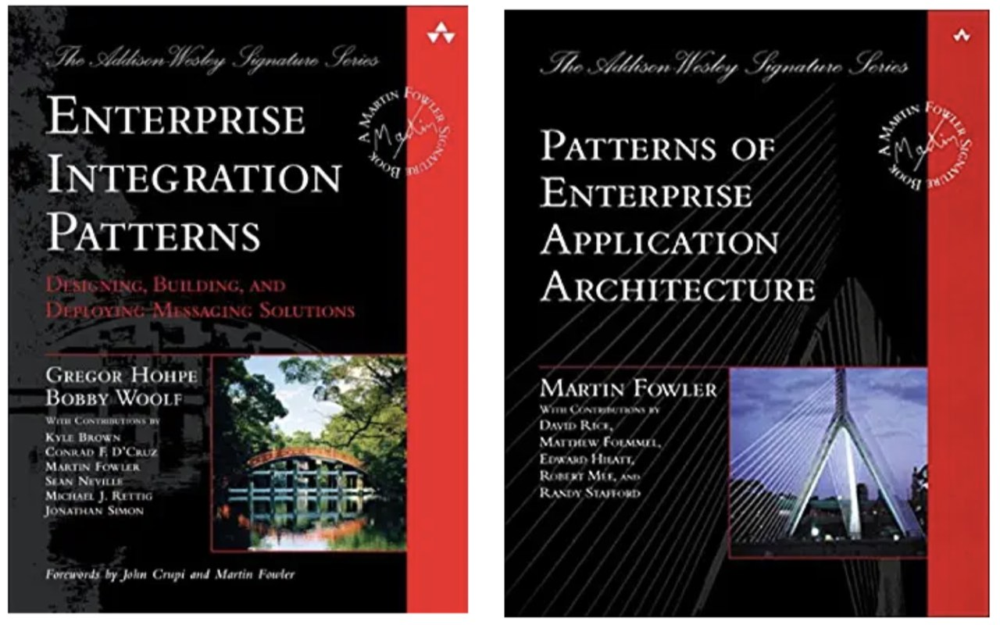
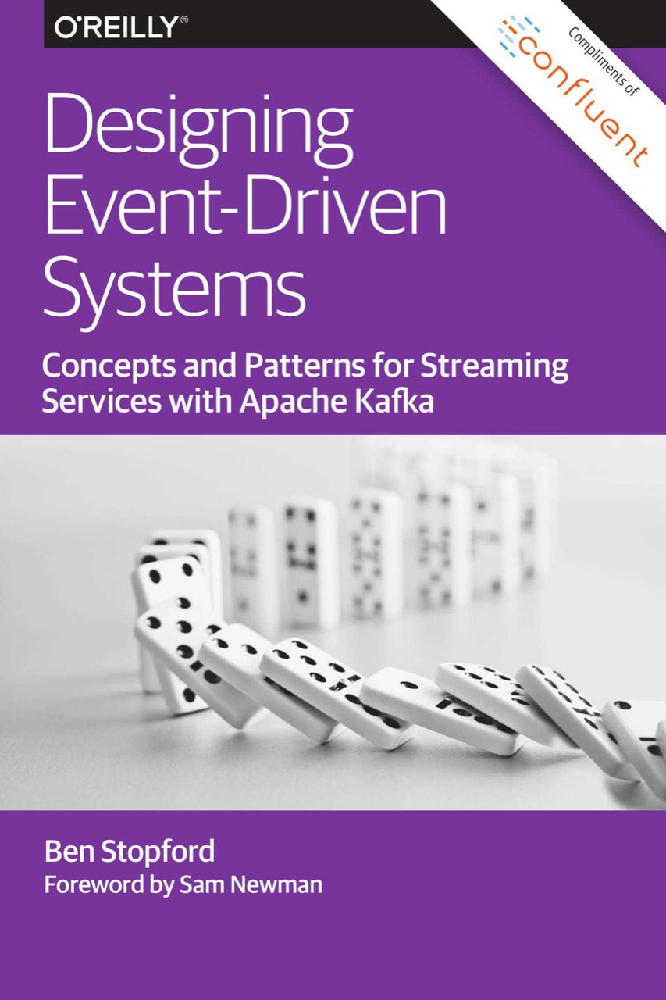
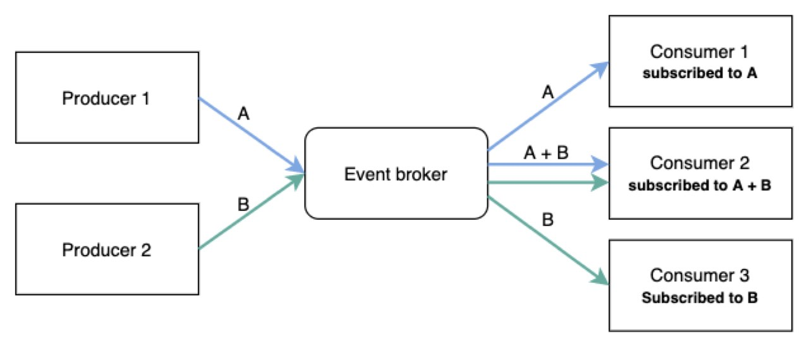
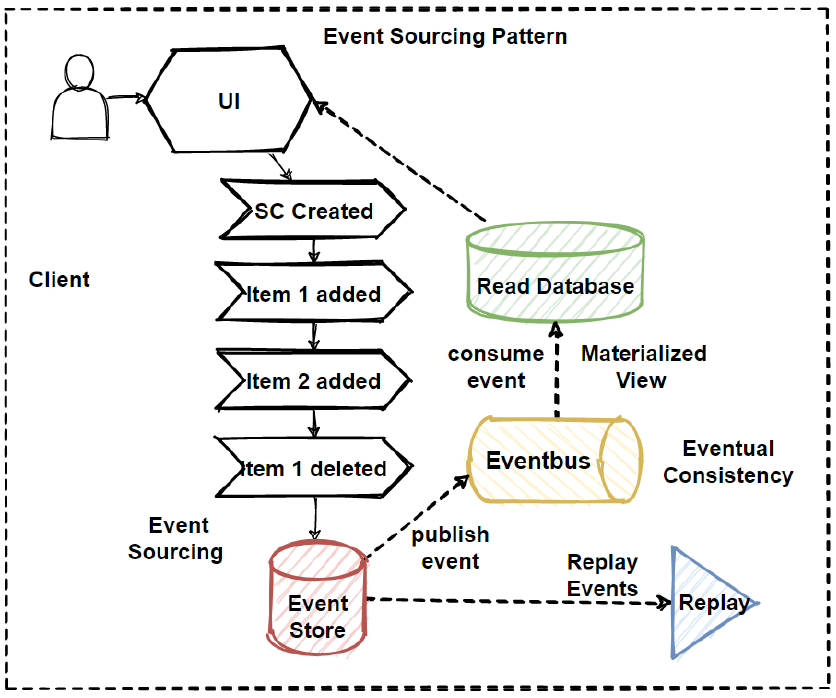
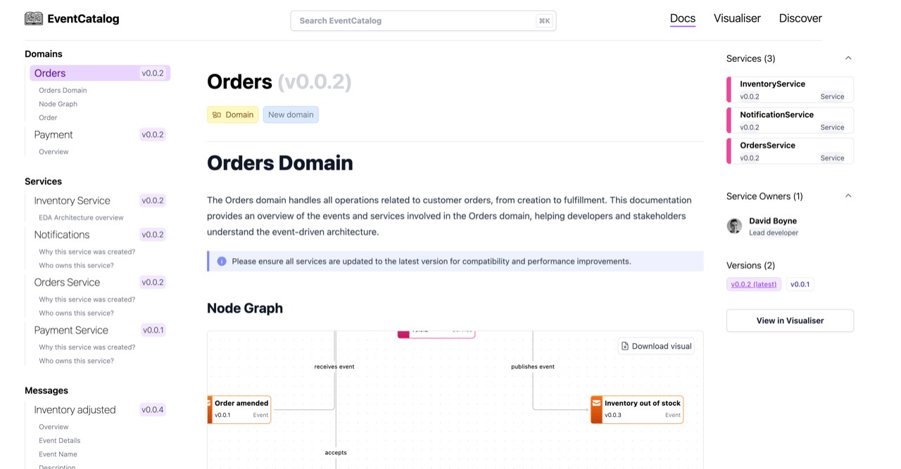
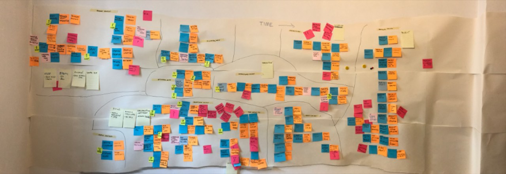
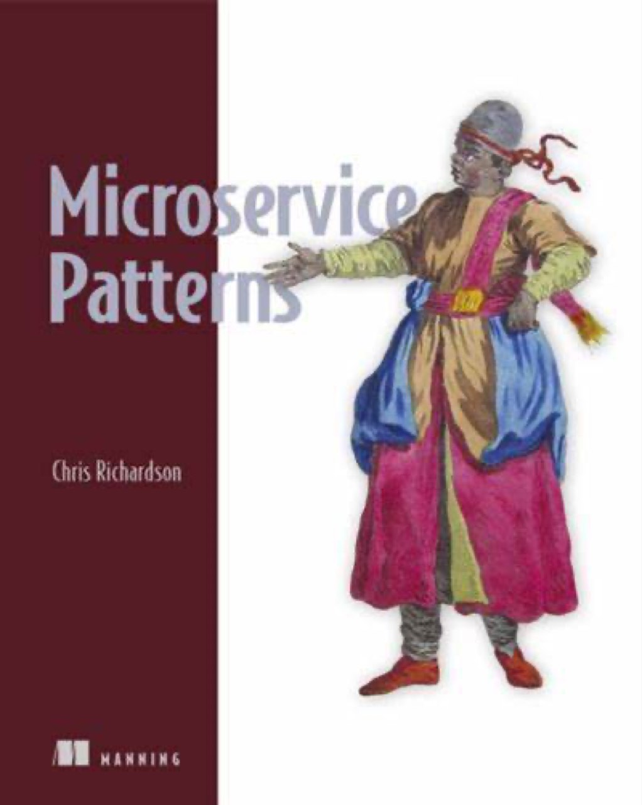
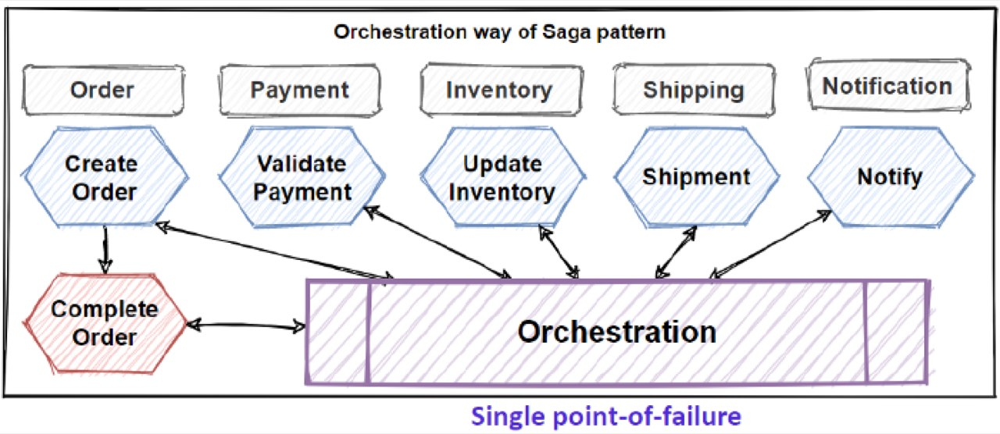
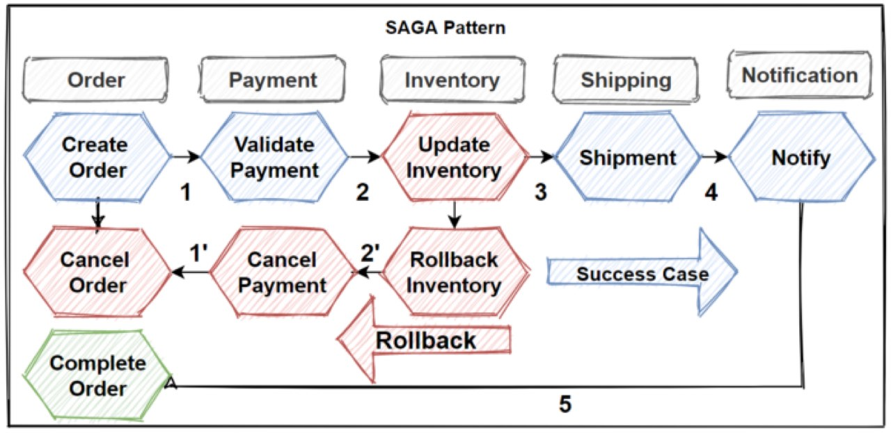
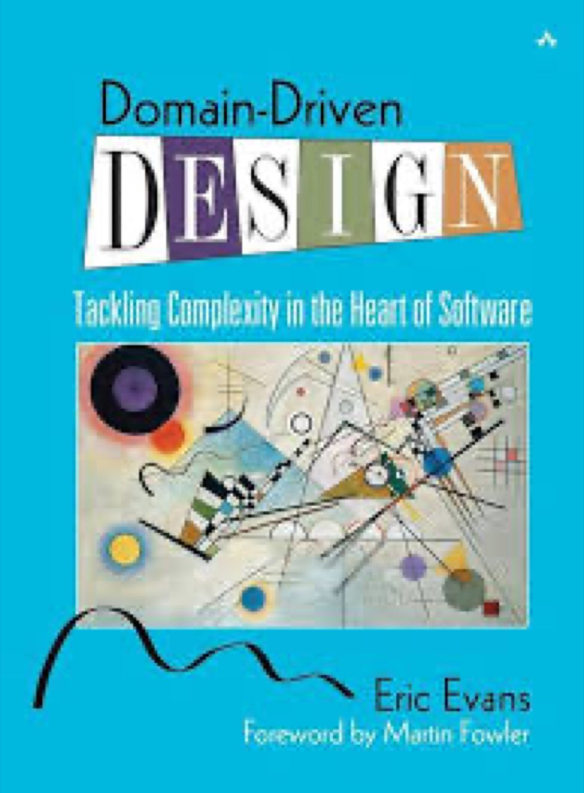

# ARQUITETURA_CLOUD_6-ESTILO_EVENTOS

> Converted from `ARQUITETURA_CLOUD_6-ESTILO_EVENTOS.pptx`.

## 1. Padrões e Estilos Arquiteturais

Professor Manoel Valerio da Silveira Neto

## 2. Event-Driven Architecture (EDA)

A Event-Driven Architecture (EDA), ou Arquitetura Orientada a Eventos, é um padrão arquitetural onde os componentes de um sistema comunicam-se entre si através da geração e do consumo de eventos. Em uma EDA, um evento é uma mudança de estado significativa ou uma atualização ocorrida dentro do sistema. Os eventos são publicados por produtores e consumidos por consumidores, que reagem a esses eventos para realizar determinadas ações. Também conhecido como PUB/SUB.

## 3. Event-Driven Architecture (EDA)

Prós
- Desacoplamento: Os componentes do sistema são desacoplados, permitindo que eles evoluam de forma independente e sejam substituídos sem afetar outros componentes.
- Escalabilidade: EDA facilita a escalabilidade horizontal, já que os eventos podem ser distribuídos e processados por vários consumidores em paralelo.
- Reatividade: Os sistemas são reativos, respondendo de maneira eficiente e rápida a mudanças e atualizações em tempo real.
- Flexibilidade e Extensibilidade: Adicionar novos consumidores para processar eventos específicos é relativamente simples, sem necessidade de alterar os produtores ou outros consumidores.
- Tolerância a Falhas: A arquitetura pode ser mais resiliente a falhas, pois a perda de um consumidor não impede que os eventos sejam processados por outros consumidores.

## 4. Event-Driven Architecture (EDA)

Contras
- Complexidade: O design, implementação e manutenção de uma EDA podem ser complexos, especialmente quando se lida com a orquestração de eventos e a garantia de consistência de dados.
- Depuração e Monitoramento: Diagnosticar problemas e monitorar o fluxo de eventos em uma EDA pode ser desafiador, devido à natureza assíncrona e distribuída dos eventos.
- Consistência Eventual: A EDA frequentemente opera sob o modelo de consistência eventual, o que pode ser inadequado para sistemas que exigem consistência imediata dos dados.
- Gerenciamento de Estado: Gerenciar o estado entre diferentes componentes que reagem a eventos pode ser difícil, especialmente em cenários complexos com muitas dependências entre eventos.
- Latência: A latência pode ser introduzida pela fila de eventos e pelo processamento assíncrono, o que pode não ser aceitável para todas as aplicações.

## 5. Event-Driven Architecture (EDA)

## 6. Event-Driven Architecture (EDA)

Plataformas de Processamento de Eventos
Apache Flink
Apache Storm
Ferramentas de Monitoramento e Observabilidade
Prometheus
Grafana

Tecnologias de Streaming e Mensageria
Apache Kafka
RabbitMQ
Amazon EventBridge
Azure Event Grid
Google Cloud Pub/Sub
Frameworks e Bibliotecas
Spring Cloud Stream
Akka
NATS

## 7. Event Sourcing

Event Sourcing é um padrão arquitetural onde as mudanças no estado de um sistema são capturadas como uma sequência de eventos imutáveis. Em vez de armazenar apenas o estado atual dos dados, o Event Sourcing armazena todos os eventos que levaram ao estado atual. Cada evento representa uma alteração ocorrida no sistema e é armazenado em um log de eventos. O estado do sistema pode ser reconstruído a qualquer momento ao reprocessar esses eventos.

[Event Sourcing (martinfowler.com)](https://martinfowler.com/eaaDev/EventSourcing.html)

## 8. Event Sourcing

Prós
- Histórico Completo: Armazenar todos os eventos permite um histórico completo e auditável de todas as mudanças no sistema.
- Reversão de Estado: Possibilita a reversão do estado do sistema para qualquer ponto no tempo, facilitando a correção de erros e análise de problemas.
- Escalabilidade: Eventos imutáveis podem ser facilmente distribuídos e processados em paralelo, facilitando a escalabilidade horizontal.
- Flexibilidade de Modelagem: Permite modelar mudanças complexas no estado de uma maneira mais natural e intuitiva.

## 9. Event Sourcing

Contras
- Complexidade: Implementar Event Sourcing pode ser complexo e requer um entendimento profundo dos conceitos e padrões associados.
- Armazenamento: O armazenamento de todos os eventos pode resultar em um grande volume de dados, aumentando os requisitos de armazenamento.
- Reconstrução de Estado: A reconstrução do estado atual a partir de um grande número de eventos pode ser lenta e exigir técnicas de otimização como snapshots.
- Consistência de Dados: Garantir a consistência e integridade dos dados pode ser desafiador, especialmente em sistemas altamente distribuídos.
- Curva de Aprendizado: Equipes de desenvolvimento podem enfrentar uma curva de aprendizado íngreme para dominar Event Sourcing e suas implicações.

## 10. Event Sourcing

## 11. Event Catalog

Documentação de eventos, publicadores e consumidores.

[EventCatalog](https://www.eventcatalog.dev/)

## 12. Event Storming (Técnica)

Event Storming é uma técnica colaborativa usada no desenvolvimento de software e na análise de negócios para modelar domínios e processos complexos. Envolve reunir partes interessadas, especialistas no domínio e desenvolvedores em um workshop para mapear os eventos, comandos e entidades principais de um sistema. O objetivo é obter uma compreensão compartilhada do domínio e identificar áreas para melhorias ou otimizações.

[EventStorming](https://www.eventstorming.com/)

## 13. Event Storming (Técnica)

## 14. SAGA Pattern

Saga Pattern é um padrão arquitetural utilizado para gerenciar transações distribuídas em sistemas de microserviços. Em vez de usar transações distribuídas tradicionais, que podem ser complexas e lentas, o Saga Pattern coordena uma série de transações locais, onde cada serviço realiza uma parte do trabalho e publica um evento ou chama o próximo serviço na sequência. Se uma parte do saga falhar, um conjunto de operações de compensação é executado para desfazer o trabalho realizado até aquele ponto.

## 15. SAGA Pattern

Tipos de Sagas
- Sagas Orquestradas:
  - Descrição: Um coordenador central (orquestrador) gerencia a execução das transações e das operações de compensação. Ele envia comandos para os serviços participantes e coordena as operações de acordo com o fluxo definido.
  - Exemplo: Um serviço central envia comandos para cada microserviço, aguardando suas respostas antes de proceder para o próximo passo.
- Sagas Coreografadas:
  - Descrição: Cada serviço participante reage a eventos e executa sua transação local. Serviços publicam eventos que desencadeiam as ações nos próximos serviços, sem um coordenador central.
  - Exemplo: Cada microserviço realiza sua operação e publica um evento. Os serviços subsequentes escutam esses eventos e agem de acordo.

## 16. SAGA Pattern

Prós
- Desempenho e Escalabilidade: Evita o bloqueio e a lentidão associados a transações distribuídas, permitindo maior escalabilidade.
- Resiliência: Fornece um mecanismo para lidar com falhas através de operações de compensação, aumentando a resiliência do sistema.
- Descentralização: No caso de sagas coreografadas, não há necessidade de um coordenador central, permitindo que cada serviço opere de forma autônoma.
- Flexibilidade: Pode ser adaptado para diferentes fluxos de trabalho e tipos de transações distribuídas.

## 17. SAGA Pattern

Contras
- Complexidade: Implementar e gerenciar sagas pode ser complexo, especialmente em sistemas grandes com muitos serviços.
- Consistência Eventual: Assegura consistência eventual, o que pode não ser adequado para todas as aplicações que requerem consistência imediata.
- Depuração e Monitoramento: Diagnosticar problemas e monitorar o fluxo de sagas pode ser difícil, especialmente em arquiteturas coreografadas.
- Operações de Compensação: Nem sempre é fácil definir operações de compensação, especialmente para ações que não são facilmente reversíveis.

## 18. SAGA Pattern

## 19. SAGA Pattern

- Sagas Coreografadas:

## 20. Domain-Driven Design

Domain-Driven Design (DDD) é uma abordagem para o design e desenvolvimento de software centrada na modelagem de problemas de negócio complexos em termos de domínios. Criado por Eric Evans, DDD enfatiza a importância de uma colaboração estreita entre desenvolvedores e especialistas no domínio para criar um modelo de domínio rico que reflita com precisão a lógica de negócio.

