# ARQUITETURA_CLOUD_6-MICROFRONTEND

> Converted from `ARQUITETURA_CLOUD_6-MICROFRONTEND.pptx`.

## 1. Padrões e Estilos Arquiteturais

Professor Manoel Valerio da Silveira Neto

## 2. Evolution of Software Architecture

- Monolithic Architecture:   Todos os componentes do aplicativo fortemente acoplados como uma  unidade.Tanto  o  frontend  quanto o  backend  em uma única base de  código.Desafios  de escalabilidade e manutenção com a complexidade.
- Frontend + Backend Separation (Hybrid Monolith):  backend  (monólito híbrido): Frontend  e  backend  separados em camadas  distintas.Oferece  flexibilidade na tecnologia de  frontend , desacopla a interface do usuário da lógica do  servidor.O   backend  pode permanecer monolítico
- Microservice Backend + Monolithic Frontend:  Backend  dividido em  microsserviços  para escalabilidade e independência. O  frontend  permanece fortemente acoplado, limitando potencialmente a escalabilidade
- Micro Frontends + Microservices:  Tanto o  frontend  quanto o  backend  divididos em unidades menores e implantáveis independentemente.

## 3. (sem título)

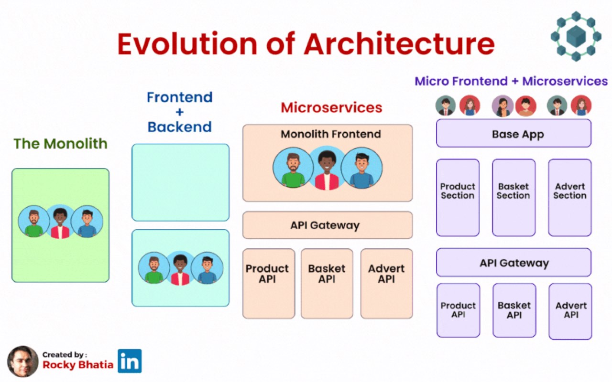

## 4. (sem título)

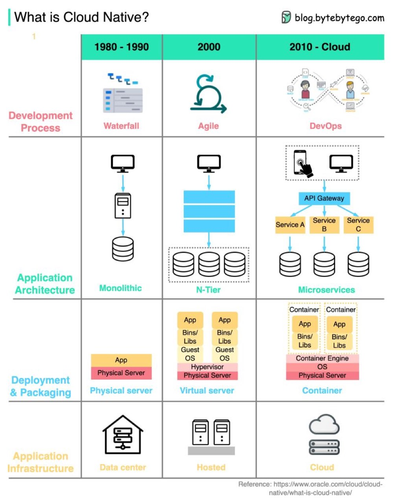

## 5. [dotnet/eShop: A reference .NET application implementing an eCommerce site (github.com)](https://github.com/dotnet/eShop)

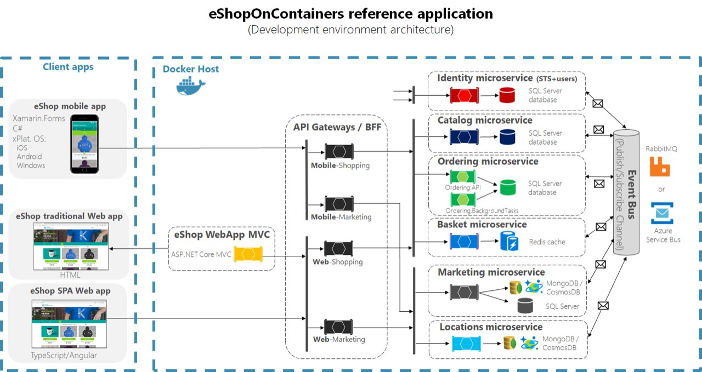

## 6. MicroFrontEnd (MFE)

## 7. MicroFrontEnd (MFE)

Microfront-end é uma abordagem de arquitetura de software que aplica os princípios de microserviços ao desenvolvimento de interfaces de usuário (UI). Em vez de criar um monolito de front-end, o MFE divide a aplicação em pequenas partes independentes, cada uma responsável por um pedaço da UI. Essas partes menores podem ser desenvolvidas, implantadas e mantidas de forma independente.

[Micro Frontends (martinfowler.com)](https://martinfowler.com/articles/micro-frontends.html)

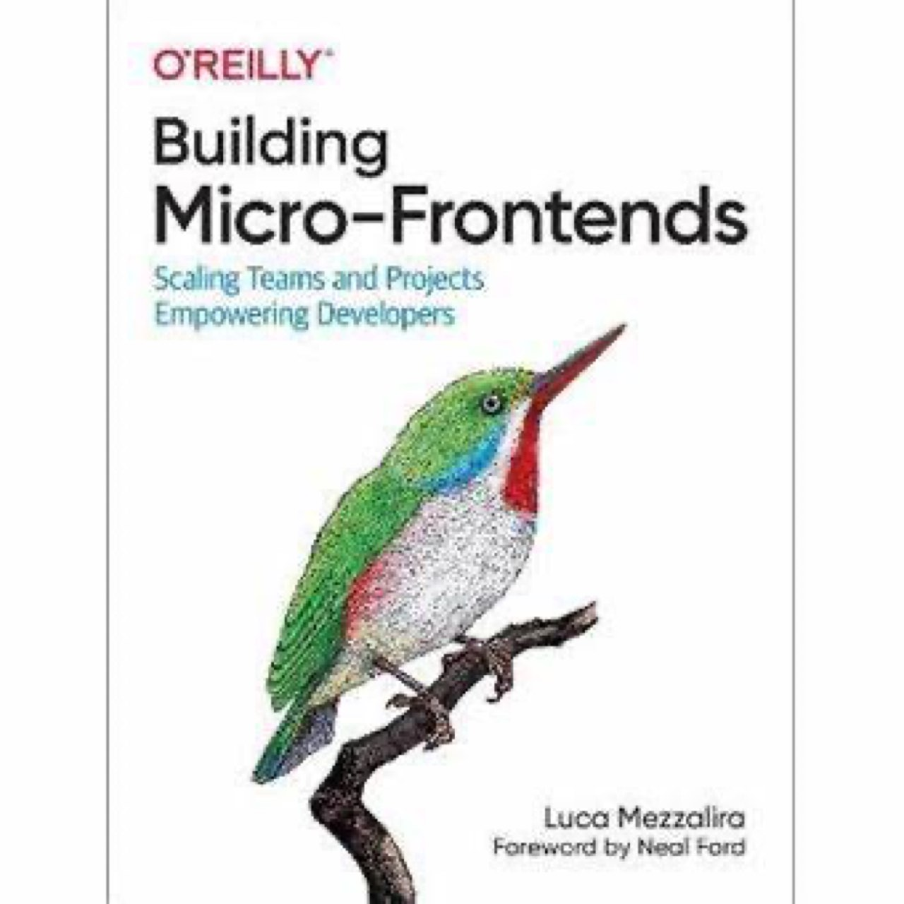

## 8. MicroFrontEnd (MFE)

Prós
- Independência de Desenvolvimento: As equipes podem trabalhar de forma independente em diferentes partes do front-end, o que aumenta a eficiência e a velocidade de desenvolvimento.
- Escalabilidade: Cada microfront-end pode ser escalado de forma independente, permitindo uma melhor gestão de recursos.
- Flexibilidade Tecnológica: Equipes diferentes podem usar diferentes frameworks e bibliotecas para seus microfront-ends, permitindo a adoção de tecnologias mais adequadas para cada parte do sistema.
- Desdobramento Contínuo: Microfront-ends podem ser implantados independentemente, permitindo atualizações mais rápidas e frequentes sem afetar toda a aplicação.
- Manutenibilidade: Facilita a manutenção e o gerenciamento do código, pois o código está dividido em partes menores e mais gerenciáveis.

## 9. MicroFrontEnd (MFE)

Contras
- Complexidade de Integração: Integrar múltiplos microfront-ends pode ser complexo, exigindo uma arquitetura bem planejada para garantir que tudo funcione em conjunto de forma harmoniosa.
- Sobrecarga de Configuração: A configuração inicial para criar uma arquitetura de microfront-end pode ser mais trabalhosa em comparação com um monolito.
- Consistência de UI/UX: Garantir uma experiência de usuário consistente através de diferentes microfront-ends pode ser desafiador, especialmente se equipes diferentes usarem tecnologias e padrões diferentes.
- Performance: Se não for bem projetado, a carga de múltiplos microfront-ends pode impactar a performance da aplicação, especialmente no tempo de carregamento inicial.
- Gestão de Dependências: Cada microfront-end pode ter suas próprias dependências, o que pode levar a problemas de compatibilidade e aumento do tamanho do bundle final.

## 10. MicroFrontEnd (MFE)

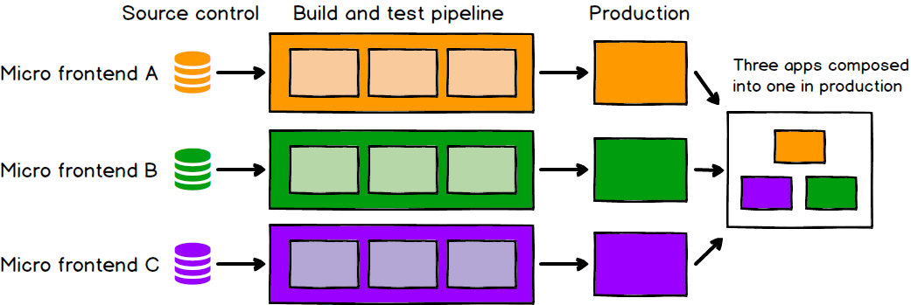

## 11. [dotnet/eShop: A reference .NET application implementing an eCommerce site (github.com)](https://github.com/dotnet/eShop)

## 12. Module Federation

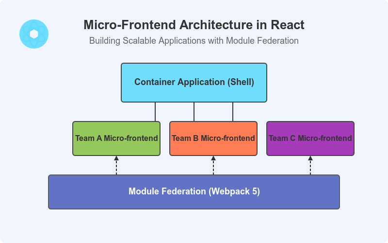

[Module Federation in React — A Practical 15‑Minute Guide (with configs & data‑sharing patterns) | by Abhinav Singh | Medium](https://medium.com/@iamabhinav30/module-federation-in-react-a-practical-15-minute-guide-with-configs-data-sharing-patterns-1a4a4948a8b8)

## 13. Module Federation

É um recurso que permite que uma aplicação carregue módulos de outra aplicação em runtime
Cada parte pode ser desenvolvida, publicada e implantada de forma independente
Evita empacotar tudo em um único frontend monolítico
Permite compartilhar:
  - componentes React
  - páginas
  - bibliotecas
  - dependências comuns
Exemplo:
  - app principal (host/shell)
  - app de catálogo
  - app de checkout
  - app de perfil do usuário

## 14. Module Federation : Relação com MFE

Microfrontend é o conceito arquitetural:
- dividir o frontend em partes menores
- cada parte alinhada a um domínio de negócio
- equipes podem trabalhar com mais autonomia
Module Federation é uma das tecnologias que viabilizam esse modelo
- microfrontend define como organizar
- Module Federation define como integrar
Benefícios dessa combinação:
- deploy independente
- escalabilidade organizacional
- menor acoplamento entre times
- evolução incremental do frontend
Atenções:
- governança de design system
- versionamento
- roteamento
- autenticação
- comunicação entre microfrontends

## 15. Comunicação -Swagger

Swagger é um conjunto de ferramentas para documentar, projetar, testar e consumir APIs REST.
Ele utiliza a especificação OpenAPI, normalmente escrita em YAML ou JSON, para descrever:

## 16. Comunicação -Swagger

As principais ferramentas são:
  - Swagger UI: gera uma página interativa para visualizar e testar a API;
  - Swagger Editor: permite escrever e validar a especificação; [SwaggerEditor](https://editor.swagger.io/)
  - Swagger Codegen: gera código de clientes e servidores;
  - SwaggerHub: plataforma colaborativa para projetar e gerenciar APIs.
  - Em termos práticos, o Swagger/OpenAPI funciona como um contrato da API entre quem desenvolve o backend e quem consome os serviços. Uma distinção importante: OpenAPI é a especificação; Swagger é o ecossistema de ferramentas que trabalha com essa especificação.

## 17. Comunicação -Swagger

A OpenAPI Specification (OAS) não é uma RFC. Ela é uma especificação mantida pela OpenAPI Initiative para descrever APIs HTTP, mas utiliza e referencia diversas RFCs que estabelecem os padrões de comunicação, endereçamento, serialização, autenticação e representação de dados.
RFC 9110	HTTP Semantics	Define métodos HTTP, códigos de resposta, cabeçalhos, representação de recursos, negociação de conteúdo e semântica das requisições.

## 18. Professor – Exemplo de criação de MFE

[SwaggerEditor](https://editor.swagger.io/) -&gt; Ver  Swagger Petstore - OpenAPI 3.2 ou Definir um prompt e solicitar para IAG criar o SWAGGER YAML.
Importar o Swagger no https://app.apidog.com/
Utilizando IA, boltz ou copilot.

[manoelvsneto/AULA_ARQSOL_MFE: Exemplo de MFE para disciplina de arquitetura de soluções](https://github.com/manoelvsneto/AULA_ARQSOL_MFE)

## 19. Atividade Formativa/Somativa – 0.1

Em grupo PJBL, alunos criar frontend (opcional utilizar react, opcional utilizar o module federation). Pode utilizar.
  - No mínimo duas funcionalidades/telas do projeto PJBL .
  - No repo deve conter um arquivo GRUPO.md deve conter o nome dos alunos.
  - Comunicação do frontend com pelo menos 1 endpoint GET de Azure Functions (utilizar dados mocks). Outras funcionalidades sugiro realizar o mock com [Apidog: Plataforma API Tudo-em-Um: Design, Depuração, Mock, Teste e Documentação](https://apidog.com/pt-BR/) .
  - Informe no arquivo Prompt.md qual o prompt utilizado para gerar o frontend.
  - Publicar no Azure Web Static Apps
    - No arquivo Readme.MD deve conter o endereço do site criado no azure web Static apps. e Se utilizou o apidog para mock informar os endereços.
  - No AVA fornecer o link publico do repositório no github e azure function.

## 20. (sem título)

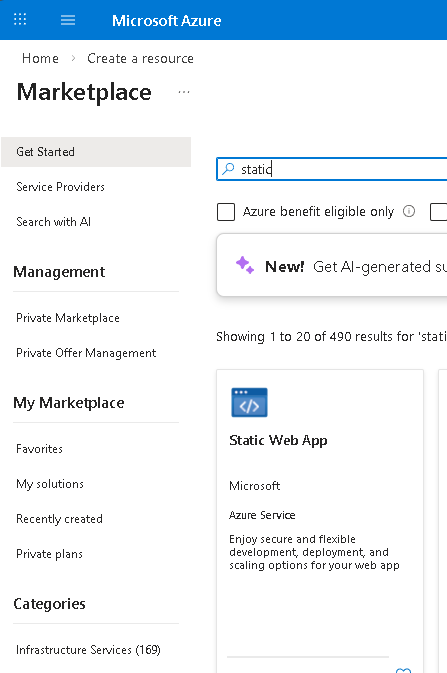

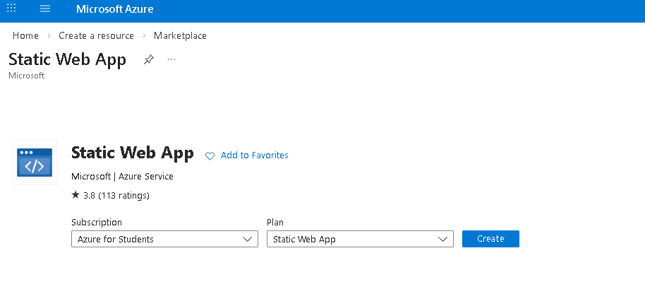

## 21. (sem título)

## 22. (sem título)

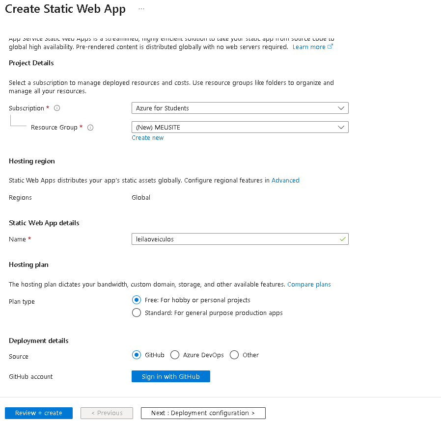

## 23. (sem título)

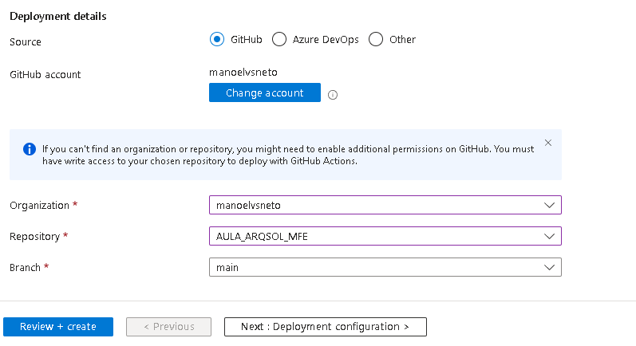

## 24. Pode acontecer erro de região , se falhar tente outra região

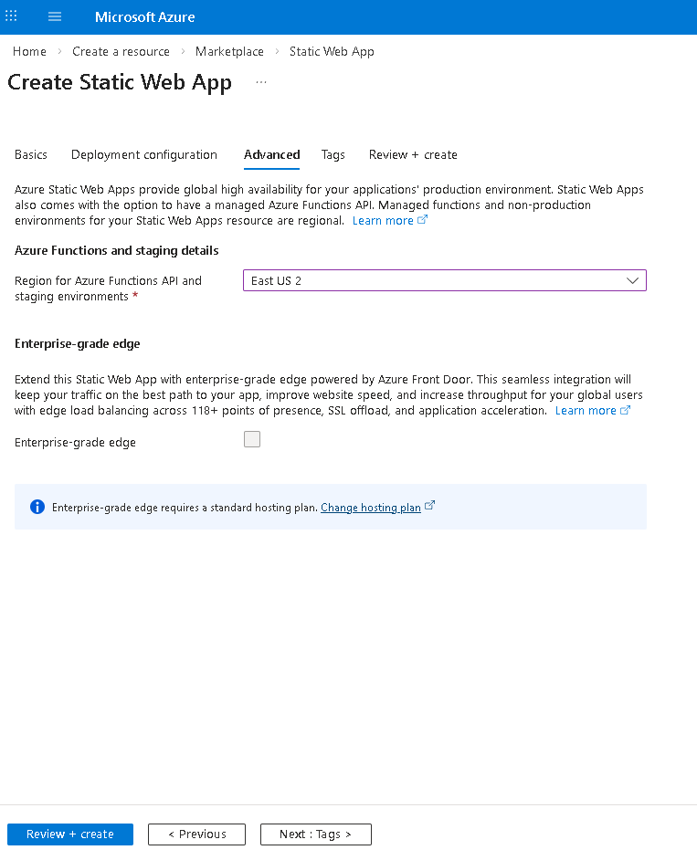

## 25. (sem título)

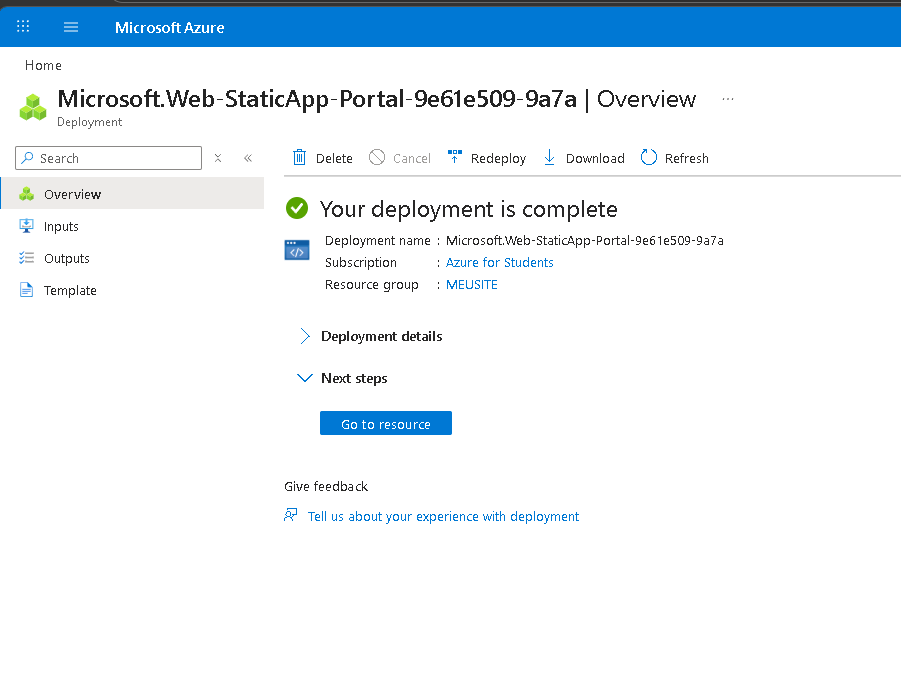

## 26. (sem título)

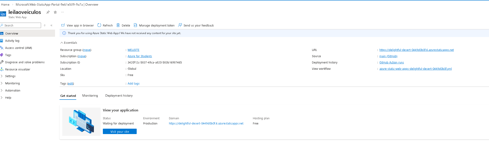

## 27. (sem título)

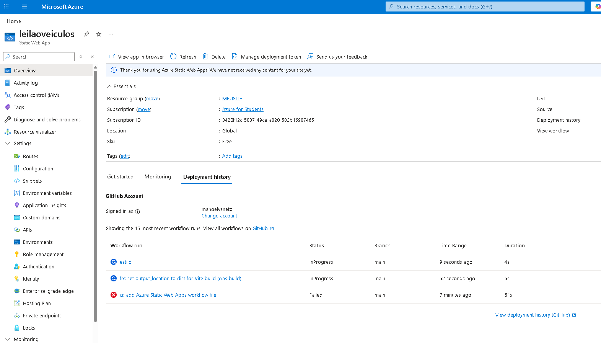

## 28. (sem título)

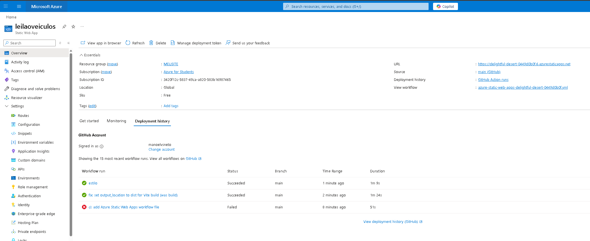

## 29. (sem título)

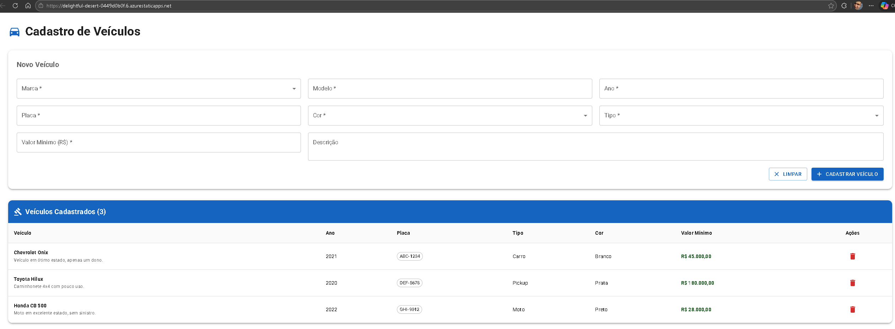

## 30. Implantação

[Documentação dos Aplicativos Web Estáticos do Azure | Microsoft Learn](https://learn.microsoft.com/pt-br/azure/static-web-apps/)
[Início Rápido: Como criar seu primeiro site estático com os Aplicativos Web Estáticos do Azure | Microsoft Learn](https://learn.microsoft.com/pt-br/azure/static-web-apps/getting-started?tabs=react)
