# ARQUITETURA_CLOUD-CLEAN_CODE

> Converted from `ARQUITETURA_CLOUD-CLEAN_CODE.pptx`.

## 1. Clean Architecture

Professor Manoel Valerio da Silveira Neto

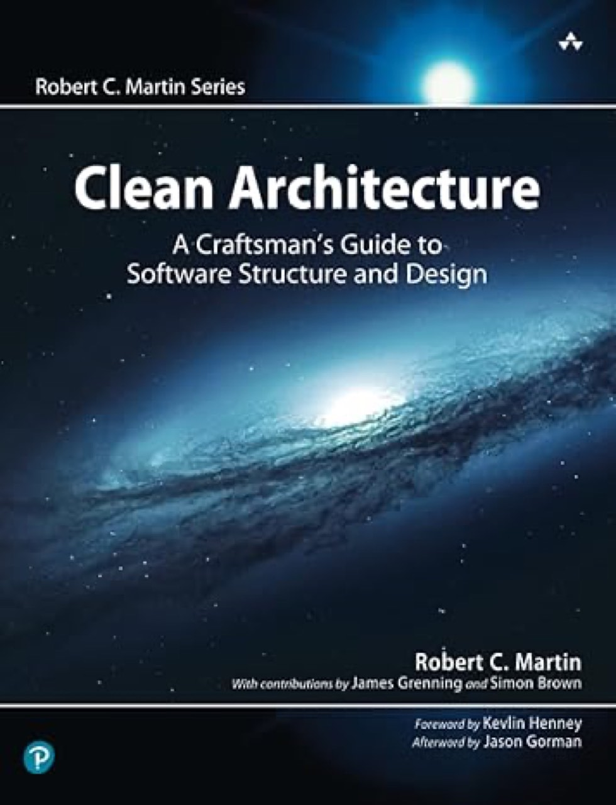

## 2. Agenda

Introdução
Camadas e dependências
Componentização e Modularidade
Princípios SOLID e Clean Architecture
Práticas de Implementação

## 3. Introdução - O que é Clean Architecture?

Definição:
  - Arquitetura proposta por Robert C. Martin (Uncle Bob), Tio Bob.
  - Foca na organização de sistemas em camadas para garantir baixa dependência entre as partes do sistema.
Objetivo principal: Tornar o sistema flexível, fácil de testar, e resiliente a mudanças.
Principais Benefícios:
  - Alta coesão, baixo acoplamento.
  - Independência de frameworks e detalhes de implementação.
  - Facilita a testabilidade e manutenção.

## 4. Introdução – Motivação

Motivação:
- Evitar que aplicações grandes se tornem difíceis de manter.
- Manter a lógica de negócio independente de detalhes de implementação (banco de dados, UI, frameworks).
Problemas comuns resolvidos:
- Acoplamento excessivo entre componentes.
- Dificuldade para testar partes do sistema.
- Dependência direta em frameworks, dificultando trocas ou atualizações.
Soluções:
- Separar as preocupações em camadas claras e bem definidas.
- Aplicar a regra de dependência: dependências devem sempre apontar para o interior, ou seja, da camada externa para a interna.

## 5. Camadas e dependências - Estrutura

Principais Camadas:
  - Entidades (Entities)
  - Casos de Uso (Use Cases)
  - Interface de Controle (Controllers)
  - Gateways (Infraestrutura)

## 6. Regra de Ouro:

- As dependências devem sempre apontar para dentro, em direção às camadas de maior valor para o negócio.
Explicação Visual:
- Diagrama mostrando as camadas em anéis concêntricos:
  - No centro, Entidades.
  - Ao redor, Casos de Uso.
  - Depois, Interface de Controle.
  - Por último, Gateways (Infraestrutura).
Exemplo Prático: Um controlador pode depender de um caso de uso, mas o caso de uso não pode depender do controlador.

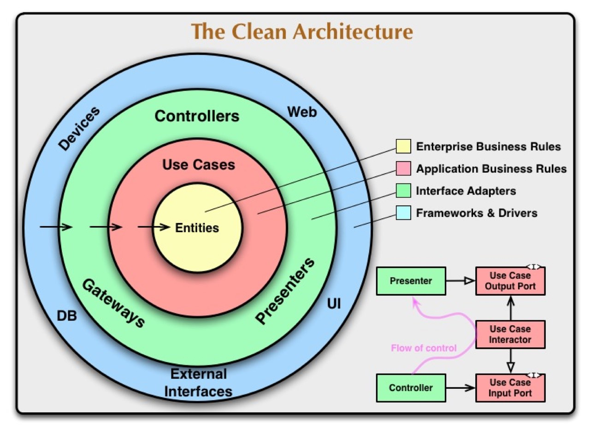

## 7. Camadas e dependências - Estrutura

Principais Camadas:
- Entidades (Entities):
  - Representam o núcleo da lógica de negócios, são independentes de qualquer tecnologia ou infraestrutura.
  - Exemplo: Classes que modelam o domínio, como Cliente, Pedido, etc.

## 8. Camadas e dependências - Estrutura

Principais Camadas:
- Casos de Uso (Use Cases):
  - Contêm a lógica específica das regras de negócio aplicadas. São responsáveis por coordenar o fluxo de dados entre as entidades e as camadas externas.
  - Exemplo: Cadastrar Cliente, Processar Pedido.

## 9. Camadas e dependências - Estrutura

Principais Camadas:
- Interface de Controle (Controllers):
  - Camada responsável por orquestrar as entradas do sistema e chamar os casos de uso apropriados.
  - Exemplo: Controladores REST ou interface de usuário.

## 10. Camadas e dependências - Estrutura

Principais Camadas:
- Gateways (Infraestrutura):
  - Onde residem as interações com o mundo externo, como bancos de dados, APIs, interfaces de usuário, frameworks, etc.
  - Exemplo: Repositórios de dados, conexões com bancos de dados.

## 11. Camadas e dependências – Exemplo de Dependencia

Observações:
- Nenhuma camada interna depende das externas.
- Camadas externas são detalhes que podem ser facilmente substituídos (banco de dados, interface de usuário, frameworks).

## 12. Componentização e Modularidade - Componentização na Clean Architecture

O que é Componentização?
- Divisão do sistema em componentes menores e independentes que podem ser desenvolvidos, mantidos e testados separadamente.
- Cada componente deve ser responsável por uma única responsabilidade ou conjunto coeso de funcionalidades.
Benefícios da Componentização:
- Reutilização: Componentes podem ser usados em diferentes partes do sistema ou até mesmo em outros projetos.
- Facilidade de Substituição: Alterar ou melhorar um componente sem impactar outros.
- Testabilidade: Componentes pequenos e focados são mais fáceis de testar de maneira isolada.
Exemplo: Um módulo de "Autenticação" separado do módulo de "Processamento de Pagamentos".

## 13. Componentização e Modularidade - Modularidade na Clean Architecture

Modularidade:
- Modularidade refere-se à separação lógica do sistema em módulos ou pacotes, onde cada módulo tem uma função específica e não depende diretamente de outros módulos.
Princípios Chave:
- Separação de Responsabilidades: Cada módulo deve focar em um aspecto específico do sistema.
- Interdependência Controlada: Evitar dependências cíclicas entre módulos.
- Camadas Independentes: Cada camada da Clean Architecture (Entidades, Casos de Uso, etc.) pode ser implementada como um módulo separado.
Vantagens:
- Escalabilidade: Facilita a expansão do sistema, permitindo a adição de novas funcionalidades sem impactar módulos existentes.
- Manutenção: Melhor organização e menos dependências ajudam na manutenção.

## 14. Princípios SOLID e Clean Architecture - Introdução aos Princípios SOLID

O que é SOLID.?
- Conjunto de cinco princípios de design de software que ajudam a construir sistemas mais flexíveis, manuteníveis e fáceis de evoluir.
Princípios:
S: Single Responsibility Principle (SRP)
O: Open-Closed Principle (OCP)
L: Liskov Substitution Principle (LSP)
I: Interface Segregation Principle (ISP)
D: Dependency Inversion Principle (DIP)

## 15. Princípios SOLID e Clean Architecture - Princípios SOLID. Aplicados na Clean Architecture

Como os princípios SOLID são aplicados na Clean Architecture:
Single Responsibility Principle (SRP)
  - Cada classe ou módulo deve ter uma única responsabilidade.
  - Na Clean Architecture, isso é refletido nas camadas bem definidas, como os Casos de Uso, que possuem uma única função no sistema.

## 16. Princípios SOLID e Clean Architecture - Princípios SOLID. Aplicados na Clean Architecture

Como os princípios SOLID são aplicados na Clean Architecture:
Open-Closed Principle (OCP)
  - As classes devem ser abertas para extensão, mas fechadas para modificação.
  - As camadas internas da Clean Architecture (Entidades e Casos de Uso) não precisam ser alteradas quando novos comportamentos são adicionados, pois novos componentes externos (por exemplo, controladores ou repositórios) podem ser estendidos sem modificar o núcleo.

## 17. Princípios SOLID e Clean Architecture - Princípios SOLID Aplicados na Clean Architecture

Liskov Substitution Principle (LSP)
  - Subclasses ou implementações derivadas devem poder ser substituídas por suas classes base sem alterar o comportamento do sistema.
  - No contexto da Clean Architecture, essa prática ajuda a manter as interfaces de controle e repositório funcionando corretamente mesmo com diferentes implementações.

## 18. Princípios SOLID e Clean Architecture - Princípios SOLID Aplicados na Clean Architecture

Dependency Inversion Principle (DIP)
  - Módulos de alto nível não devem depender de módulos de baixo nível; ambos devem depender de abstrações (interfaces).
  - Isso está no coração da Clean Architecture, onde as camadas internas nunca dependem das externas, mas sim de interfaces, promovendo independência.

## 19. Princípios SOLID e Clean Architecture - Princípios SOLID Aplicados na Clean Architecture

Interface Segregation Principle (ISP)
  - Uma classe não deve ser forçada a depender de interfaces que ela não usa.
  - Clean Architecture sugere a criação de interfaces específicas para cada caso de uso e interação, reduzindo a dependência de grandes interfaces genéricas.

## 20. Princípios SOLID e Clean Architecture - Benefícios da Aplicação de SOLID

Benefícios de SOLID na Clean Architecture:
- Baixo Acoplamento: Cada camada e componente são desacoplados e podem evoluir independentemente.
- Alta Coesão: Classes e módulos focam em uma única responsabilidade, tornando o código mais claro e fácil de entender.
- Facilidade de Manutenção: Alterações no código afetam apenas as áreas necessárias, sem impactos desnecessários.
- Testabilidade: Módulos menores e bem definidos facilitam a criação de testes unitários e de integração.

## 21. Exemplo Implementação C# - CRUD Pessoa com Clean Architecture – Estrutura

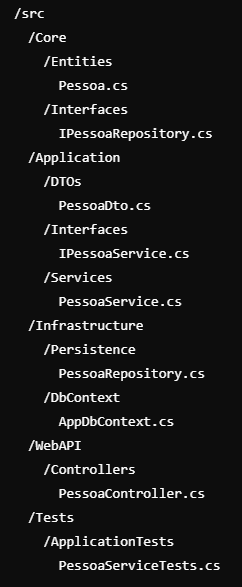

## 22. (sem título)

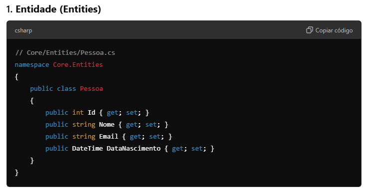

## 23. (sem título)

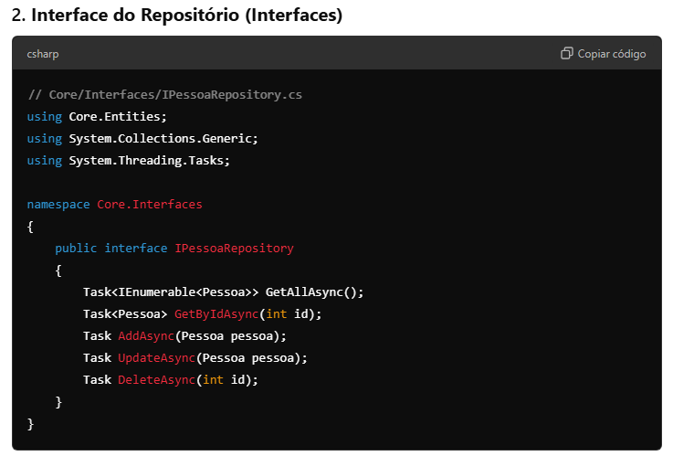

## 24. (sem título)

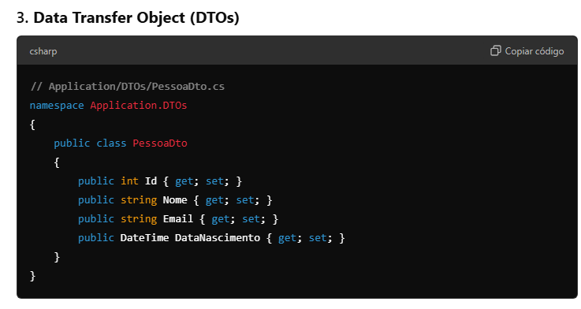

## 25. (sem título)

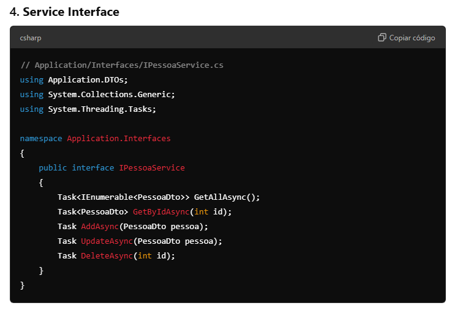

## 26. Service

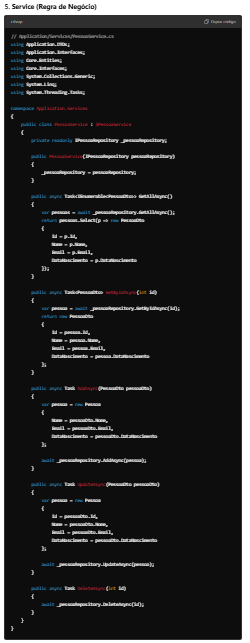

## 27. Repository

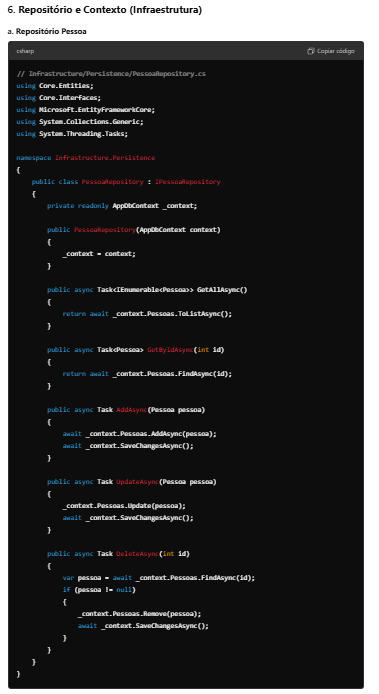

## 28. (sem título)

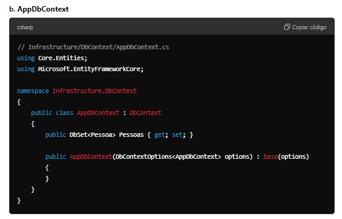

## 29. Controller

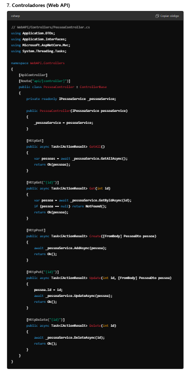

## 30. Unit Test

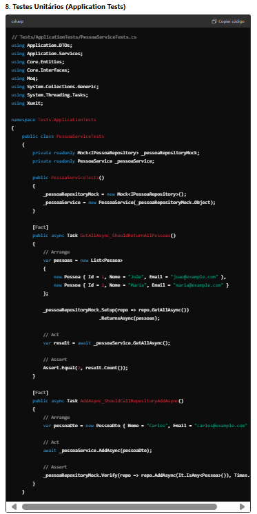

## 31. Testes de Arquitetura - ArchUnit

[TNG/ArchUnitNET: A C# architecture test library to specify and assert architecture rules in C# for automated testing. (github.com)](https://github.com/TNG/ArchUnitNET)

## 32. Testes de Arquitetura - ArchUnit

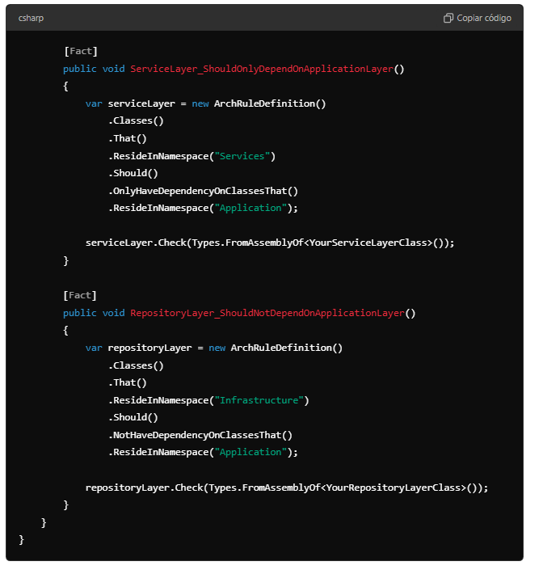

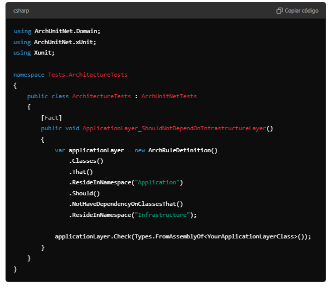

[TNG/ArchUnitNET: A C# architecture test library to specify and assert architecture rules in C# for automated testing. (github.com)](https://github.com/TNG/ArchUnitNET)

## 33. Exemplos – Clean Architecture

[pcah/python-clean-architecture: A Python toolkit for applications driven by The Clean Architecture (github.com)](https://github.com/pcah/python-clean-architecture)
[ardalis/CleanArchitecture: Clean Architecture Solution Template: A starting point for Clean Architecture with ASP.NET Core (github.com)](https://github.com/ardalis/CleanArchitecture)

## 34. Exemplos – Clean Architecture

[pcah/python-clean-architecture: A Python toolkit for applications driven by The Clean Architecture (github.com)](https://github.com/pcah/python-clean-architecture)
[ardalis/CleanArchitecture: Clean Architecture Solution Template: A starting point for Clean Architecture with ASP.NET Core (github.com)](https://github.com/ardalis/CleanArchitecture)
[ABP.IO - Modern ASP.NET Core Web Application Platform | ABP.IO](https://abp.io/)

## 35. Vertical Slice

Vertical Slice Architecture é um estilo de organização de software que busca estruturar o código por funcionalidades completas (features) em vez de por camadas técnicas (como Controllers, Services, Repositories).

## 36. Vertical Slice

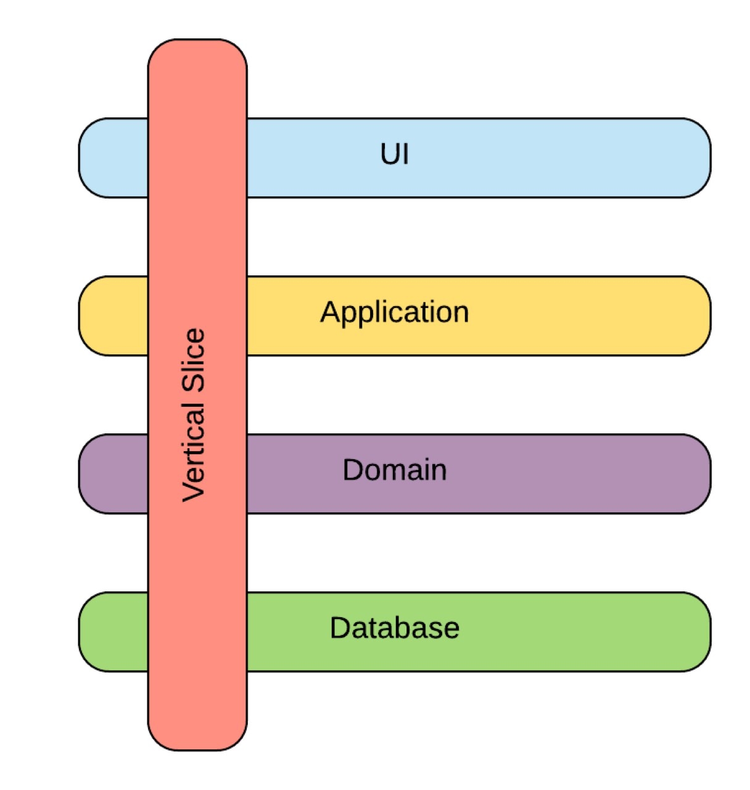

## 37. Vertical Slice

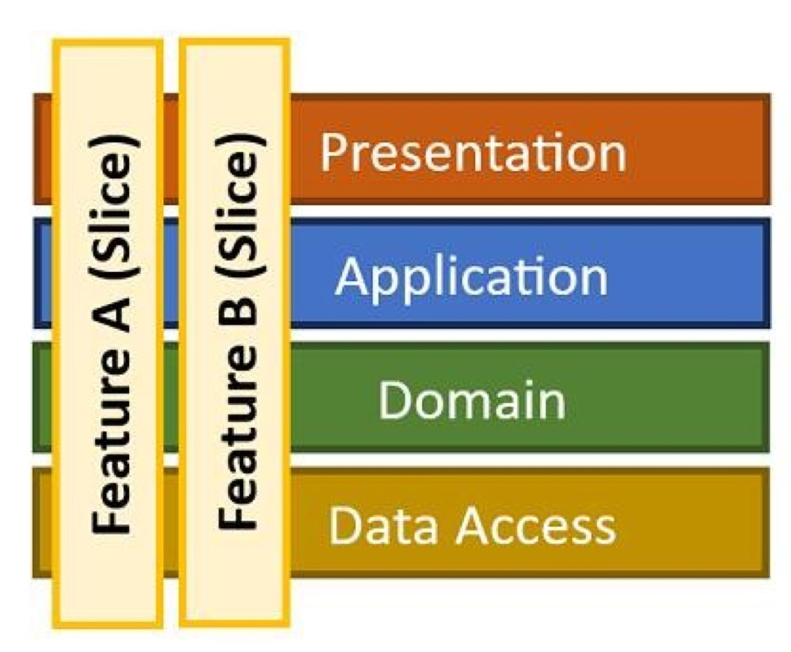

## 38. Vertical Slice

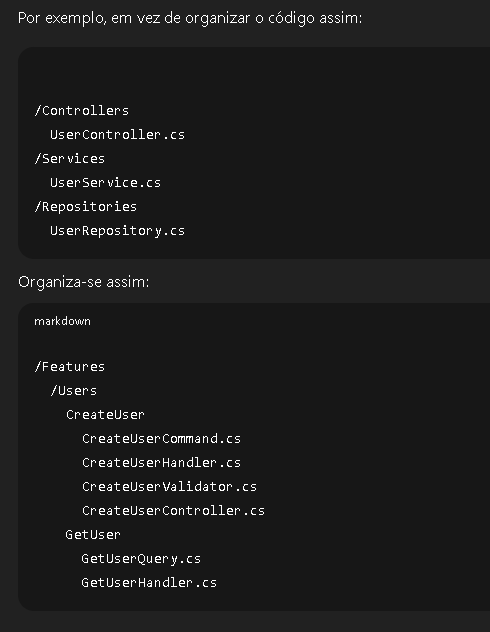
