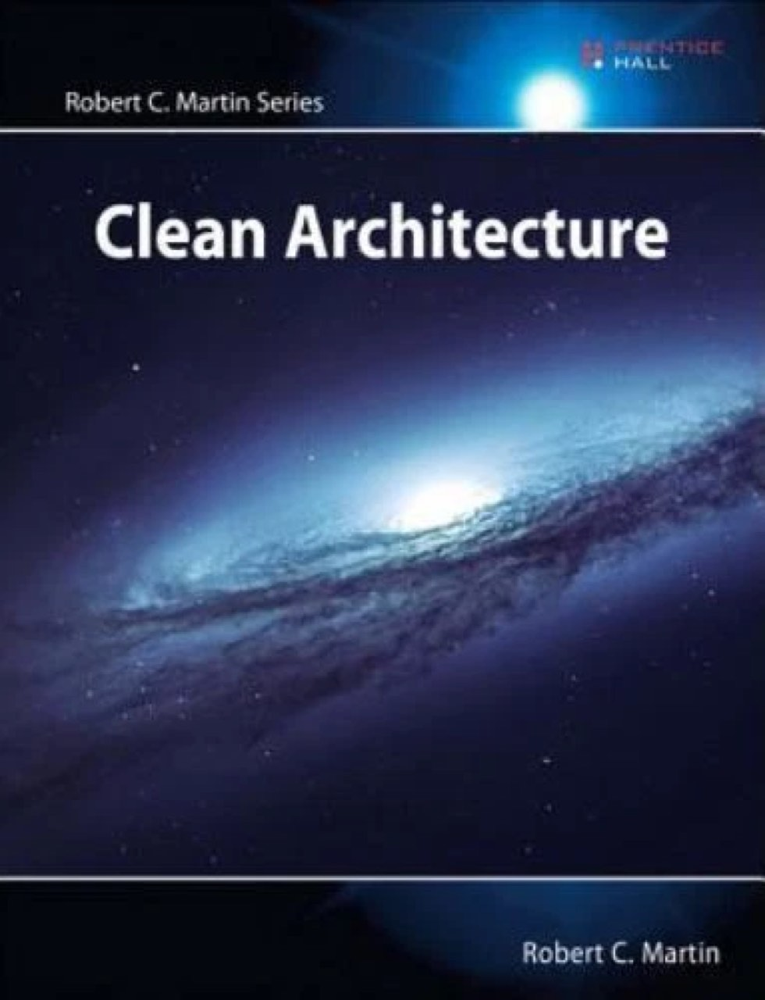

# Clean Architecture

> Converted from `Clean Architecture.pptx`.

## 1. Clean Architecture

Ideia central: proteger regras de negócio dos detalhes externos.

## 2. Uncle Bob e o livro

Robert C. Martin popularizou princípios para organizar software durável e testável.

Robert C. Martin
“Uncle Bob”

• Autor associado a Clean Code, SOLID e Clean Architecture • O foco do livro é independência: UI, banco, frameworks e agentes externos • Arquitetura como política de dependência, não como tecnologia

Clean Architecture
A Craftsman’s Guide to Software Structure and Design
2017

Regra das Dependências
Código-fonte só deve apontar para dentro, em direção às regras de negócio.

Princípio-chave

## 3. Por que usar Clean Architecture?

A arquitetura reduz o acoplamento entre regras de negócio e decisões técnicas.

Problema comum
Controller conhece SQL, regra de negócio e framework.

Clean Architecture
Política central separada de detalhes externos.

Resultado esperado
Código mais testável, substituível e evolutivo.

baixa testabilidade

baixo acoplamento

alta coesão

## 4. Desenho geral: camadas concêntricas

Quanto mais interno, mais estável e menos dependente de tecnologia.

Entities

Use Cases

Interface Adapters

Frameworks & Drivers

Dependências
apontam para dentro

1  Entities
Regras empresariais centrais

2  Use Cases
Regras de aplicação

3  Interface Adapters
Conversão entre mundo externo e interno

4  Frameworks & Drivers
UI, banco, web, dispositivos, Spring

## 5. Camada 1 — Entities

Contém regras de negócio independentes de aplicação, UI, banco ou framework.

Objetivo
Representar conceitos e invariantes do domínio: Pedido, Cliente, Conta, Produto.

• Não importa se a interface é REST, fila ou tela web • Não deve importar se o banco é PostgreSQL, Oracle ou MongoDB • Deve ser facilmente testável com testes unitários puros

Entity: Order.java

public class Order {
private final List&lt;Item&gt; items = new ArrayList&lt;&gt;();
public void addItem(Product p, int qty) {
if (qty &lt;= 0) throw new IllegalArgumentException();
items.add(new Item(p, qty));
}
public BigDecimal total() {
return items.stream()
.map(Item::subtotal)
.reduce(BigDecimal.ZERO, BigDecimal::add);
}
}

Sem Spring

Sem SQL

Sem HTTP

## 6. Camada 2 — Use Cases

Orquestra o fluxo da aplicação e aplica regras específicas de um caso de uso.

Objetivo
Executar intenções do usuário/sistema: criar pedido, aprovar crédito, calcular frete.

Input Port
CreateOrderUseCase

Interactor
CreateOrderService

Output Port
OrderRepository

Use Case: CreateOrderService.java

public class CreateOrderService
implements CreateOrderUseCase {
private final OrderRepository orders;
public OrderId execute(CreateOrderCommand cmd) {
Order order = new Order(cmd.customerId());
cmd.items().forEach(i -&gt;
order.addItem(i.product(), i.qty()));
return orders.save(order);
}
}

• Recebe dados de entrada em modelos simples • Chama entidades • Usa portas/interfaces para depender de abstrações

## 7. Camada 3 — Interface Adapters

Adapta dados externos para formatos compreendidos pelos casos de uso.

Controller

Presenter / DTO

Repository Adapter

Conversão
request ↔ command
entity ↔ response
port ↔ infraestrutura

Adapter: OrderController.java

@RestController
class OrderController {
private final CreateOrderUseCase useCase;
@PostMapping("/orders")
ResponseEntity&lt;OrderResponse&gt; create(
@RequestBody OrderRequest req) {
var cmd = req.toCommand();
var id = useCase.execute(cmd);
return ResponseEntity.created(
URI.create("/orders/" + id.value()))
.build();
}
}

Aqui Spring pode aparecer, mas ele não deve “vazar” para Use Cases ou Entities.

## 8. Camada 4 — Frameworks & Drivers

Detalhes: banco, web, dispositivos, filas, frameworks, serviços externos.

Spring MVC

JPA / Hibernate

PostgreSQL / Oracle

Kafka / RabbitMQ

Web / Mobile UI

APIs externas

Objetivo
Implementar os detalhes técnicos nas bordas, mantendo o núcleo limpo.

Driver: JpaOrderRepository.java

@Repository
class JpaOrderRepository implements OrderRepository {
private final SpringDataOrderJpa jpa;
public OrderId save(Order order) {
OrderEntity entity = OrderMapper.toJpa(order);
return new OrderId(jpa.save(entity).getId());
}
}
interface SpringDataOrderJpa
extends JpaRepository&lt;OrderEntity, UUID&gt; { }

detalhe substituível

## 9. Fluxo de execução vs. fluxo de dependências

A execução pode ir para fora; as dependências de código continuam apontando para dentro.

HTTP
Request

Controller

Use Case

Entity

Port

DB
Adapter

Execução

Dependência de código: adaptações dependem do núcleo, não o contrário

Regra prática
Use interfaces/ports para inverter dependências quando a regra interna precisa chamar um detalhe externo.

## 10. Exemplo de organização em Java

Uma estrutura possível em Java/Spring Boot mantendo o domínio isolado.

Package structure

src/main/java/br/com/exemplo/orders
├── domain
│   ├── Order.java
│   ├── Item.java
│   └── Product.java
├── application
│   ├── port
│   │   ├── in/CreateOrderUseCase.java
│   │   └── out/OrderRepository.java
│   └── service/CreateOrderService.java
├── adapters
│   ├── in/web/OrderController.java
│   └── out/persistence/JpaOrderRepository.java
└── infrastructure
├── config/BeanConfig.java
└── persistence/OrderEntity.java

domain
Entities: regra empresarial

application
Use cases e ports

adapters
Entrada/saída, DTOs, mappers

infrastructure
Spring, JPA, configuração

A divisão por módulos/projetos também é possível para reforçar a direção das dependências.

## 11. Prós e contras da Clean Architecture

A abordagem é poderosa, mas exige disciplina e contexto adequado.

Prós

• Alta testabilidade do núcleo • Baixo acoplamento com frameworks e banco • Melhor manutenção em sistemas de longa vida • Facilita troca de UI, banco ou serviço externo • Promove clareza de responsabilidades

Contras / riscos

• Pode gerar excesso de classes e interfaces • Curva de aprendizado para equipes iniciantes • Overengineering em sistemas simples • Mapeamentos e DTOs aumentam código boilerplate • Exige disciplina para não “vazar” framework para dentro

Boa decisão quando a complexidade do domínio justifica a separação.

## 12. Quando aplicar e como começar

Use Clean Architecture como direção arquitetural, não como burocracia obrigatória.

Aplique quando...

• Domínio importante e regras duradouras • Muitas integrações externas • Sistema precisa evoluir por anos • Testes automatizados são prioridade

Evite exagerar quando...

• CRUD simples e temporário • Equipe ainda não domina os princípios • Arquitetura atrapalha mais do que ajuda

1
Comece pelo domínio

2
Modele casos de uso

3
Defina ports/interfaces

4
Conecte adapters/frameworks

Referência principal
Robert C. Martin. Clean Architecture: A Craftsman’s Guide to Software Structure and Design. 2017.
