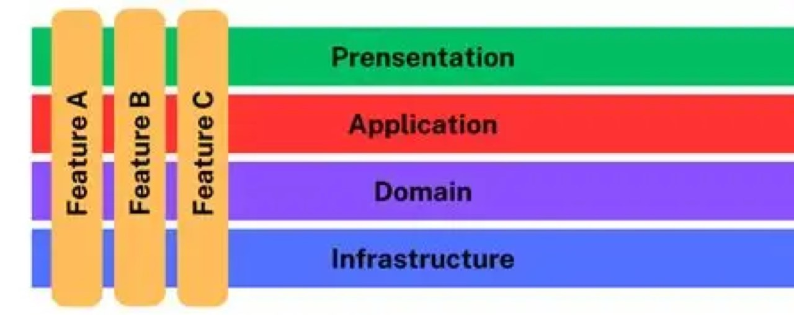

# VERTICAL SLICE

> Converted from `VERTICAL SLICE.pptx`.

## 1. Vertical Slice

Architecture

Ideia central: cada funcionalidade carrega seu próprio fluxo ponta a ponta.

Create Order

Pay Order

Cancel Order

## 2. O que é Vertical Slice Architecture?

Uma forma de modularizar o sistema por casos de uso ou funcionalidades, não por camadas técnicas globais.

Definição prática
Cada “slice” contém tudo que a funcionalidade precisa: endpoint, comando, validação, regra, persistência e testes.

• Foco na mudança: normalmente alteramos uma funcionalidade, não uma camada inteira • Reduz navegação por Controller → Service → Repository genéricos • A arquitetura continua podendo usar boas práticas de domínio, ports e testes

Slice

Entrada
Controller / Endpoint

Caso de uso
Handler / Service

Saída
Repository / Gateway

Testes do fluxo

feature-first

## 3. Camadas horizontais vs. slices verticais

A diferença principal está no eixo de modularização do código.

Arquitetura em camadas

Controllers

Services

Repositories

Models

Mudança em “Criar Pedido” atravessa várias pastas técnicas.

Vertical Slice

CreateOrder
endpoint • handler • repository • tests

PayOrder
endpoint • handler • repository • tests

CancelOrder
endpoint • handler • repository • tests

Mudança em “Criar Pedido” tende a ficar concentrada em um módulo.

## 4. Desenho geral: fatias por funcionalidade

Cada fatia cruza a pilha técnica da aplicação.

API / UI

Use Case

Domain

Database / External API

CreateOrder
Controller
Handler
Rules
Repo Adapter

PayOrder
Controller
Handler
Rules
Repo Adapter

CancelOrder
Controller
Handler
Rules
Repo Adapter

GetOrder
Controller
Handler
Rules
Repo Adapter

O corte vertical favorece coesão local: arquivos que mudam juntos ficam próximos.

## 5. Quando usar e principais mensagens

Vertical Slice não elimina arquitetura; ela muda o centro da modularização.

Use quando

• Sistema evolui por funcionalidades • Times trabalham por produto/squad • Camadas genéricas viraram gargalo • Você quer testes por comportamento

Evite quando

• Domínio ainda é muito incerto • Time não domina modularização • Há excesso de cópia sem critério • O produto é CRUD simples e pequeno

Checklist final

• Slice pequena • Responsabilidade clara • Testes próximos • Shared mínimo • Dependências explícitas

Mensagem final
Organize pelo que muda: a funcionalidade. Proteja o núcleo quando a regra de negócio exigir estabilidade.

## 6. (sem título)

